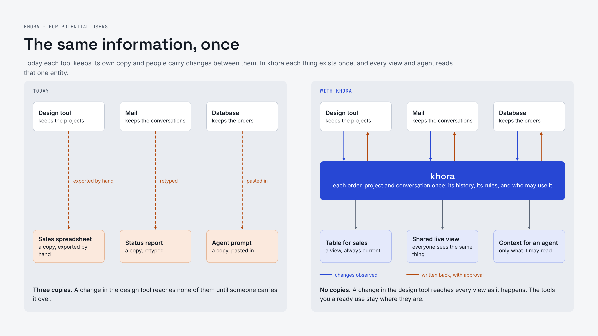
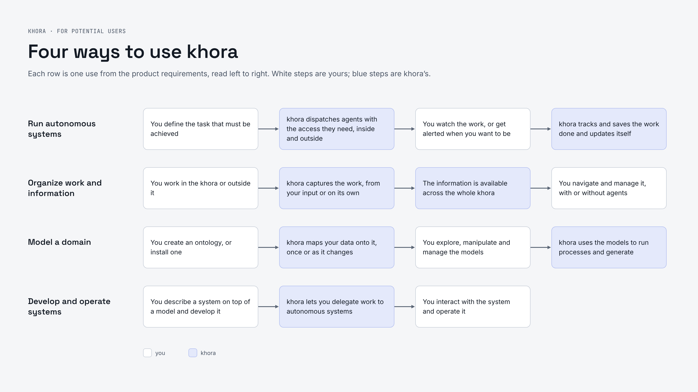
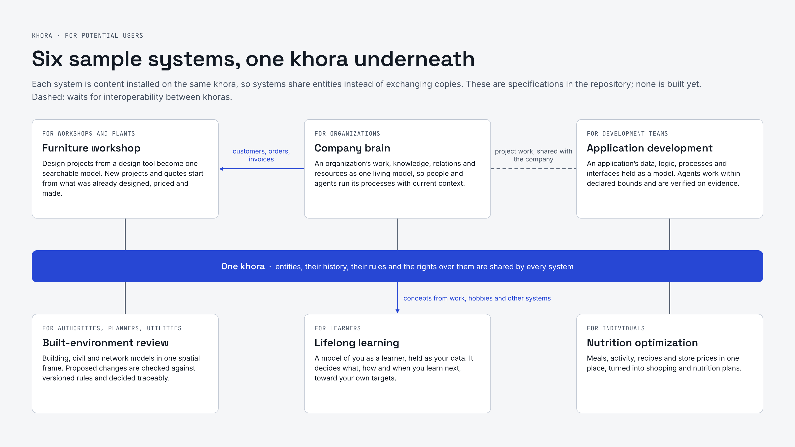
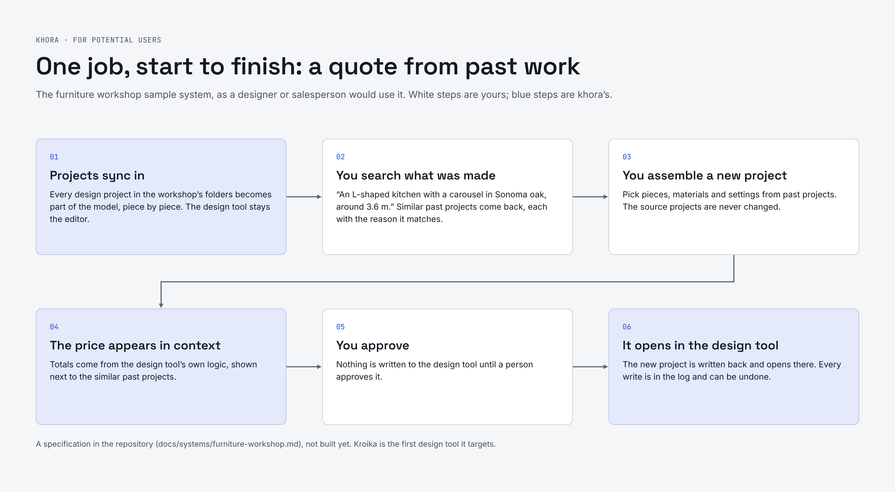
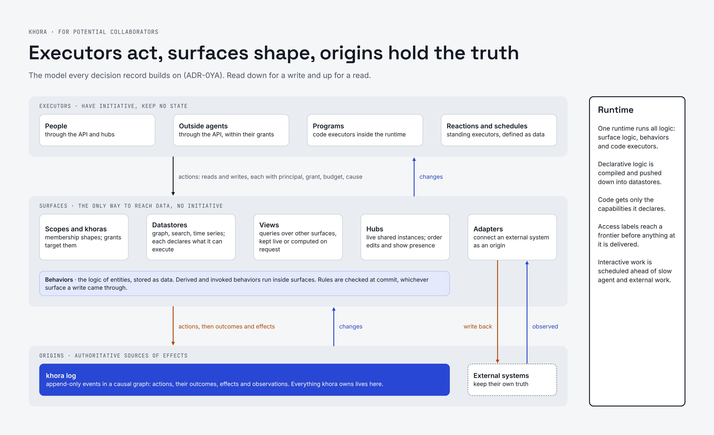
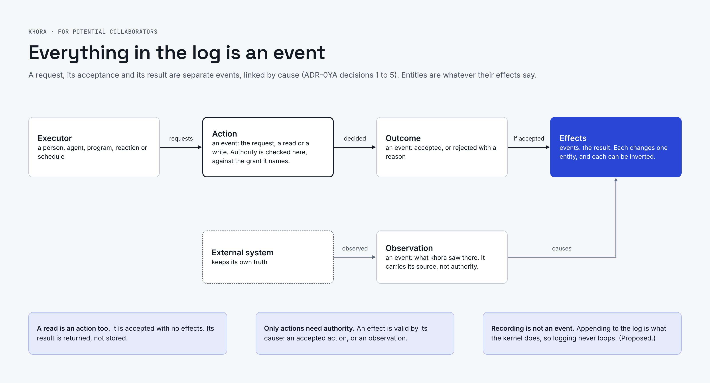
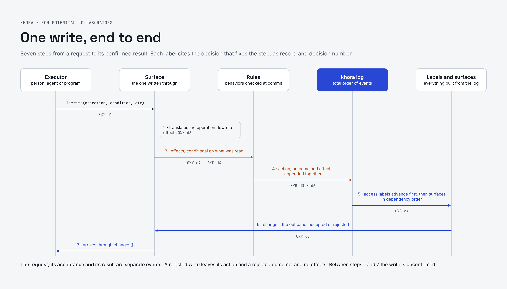
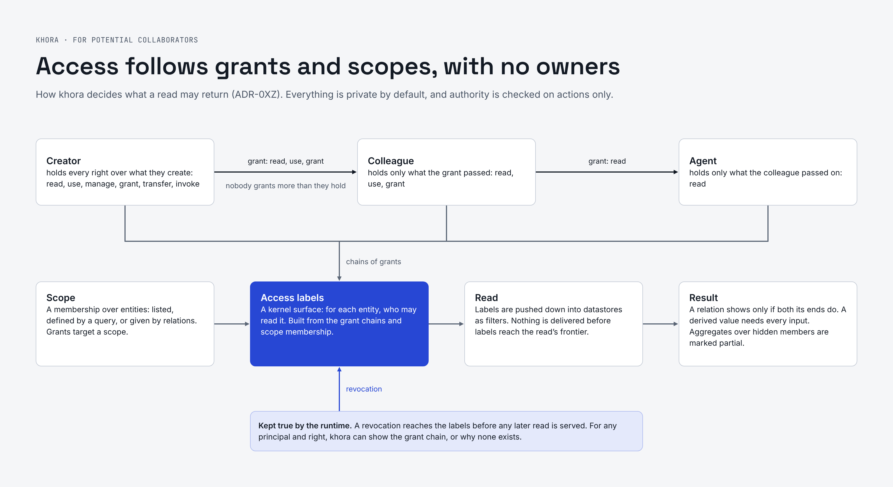

# khora

khora is a unification layer for prototyping, developing, scaling and integrating systems. Everything is data, the system grows out instead of being built, scale compounds value instead of adding cost, and meaning is stored and manipulated at its core.

## What khora is for

Each thing exists once, and every tool, view and agent reads that one entity.

The four uses from the product requirements, as steps you take and steps khora takes.

Six sample systems are specified in this repository. None is built yet.

One of them, the furniture workshop, from sync to write-back.

## How it works

Executors act, surfaces give shape, and origins hold the truth.

Everything in the log is an event. A request, its acceptance and its result are separate events.

One write, from the request to its confirmed result.

Access follows grants and scopes. No entity has an owner.

## Documents

There is no implementation code yet. The design lives in [`docs/`](docs/):

- [`docs/PRD.md`](docs/PRD.md): product requirements (draft).
- [`docs/implementation-plan.md`](docs/implementation-plan.md): implementation plan (draft): components, milestones, workstreams and tasks.
- [`docs/adr/`](docs/adr/): architecture decision records (proposed). Read ADR-0YA first.
  - [Origins, behaviors, surfaces and executors](docs/adr/origins-behaviors-surfaces-executors.md) (ADR-0YA): the model
  - [The khora log](docs/adr/khora-log.md) (ADR-0YB)
  - [Surfaces](docs/adr/surfaces.md) (ADR-0XY)
  - [Surface logic](docs/adr/surface-logic.md) (ADR-0XX)
  - [Scopes, khoras and rights](docs/adr/scopes-khoras-and-rights.md) (ADR-0XZ)
  - [Runtime and executors](docs/adr/runtime-and-executors.md) (ADR-0YC)
  - [Behaviors and processes](docs/adr/behaviors-and-processes.md) (ADR-0YD)
  - [Security model](docs/adr/security-model.md) (ADR-0YE, stub)
- [`docs/visuals/`](docs/visuals/): the images above.
- [`docs/systems/`](docs/systems/): sample domain system specs, written with the [specification template](docs/systems/template.md).
  - [Nutrition optimization](docs/systems/nutrition-optimization.md)
  - [Built-environment review](docs/systems/built-environment-review.md)
  - [Lifelong learning](docs/systems/lifelong-learning.md)
  - [Company brain](docs/systems/company-brain.md)
  - [Application development](docs/systems/application-development.md)
  - [Furniture workshop](docs/systems/furniture-workshop.md)
