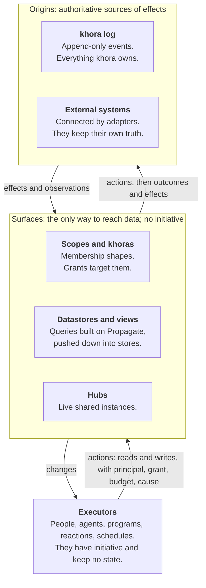
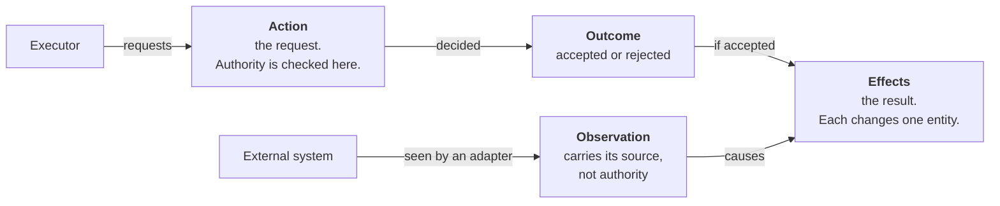

# khora: implementation plan

> **Status:** Draft for the team session
> **Date:** 13.11.2026
> **Built from:** the decision records in `docs/adr/`, including the event model of 13.11.2026

## Purpose

The goal is a working kernel with a few base systems, on which domain systems are built, as on an operating system's kernel. The plan has four stages. The kernel core is built together; from stage 2 on, each person builds the system they need and pulls kernel capabilities with it.

Three kinds of statement appear below:

- **Decided:** taken from a decision record, cited as "0YB d3" (record ADR-0YB, decision 3).
- **MVP cut:** what a record's own MVP section keeps in and leaves for later.
- ***Suggestion*:** proposed in this plan, not decided in any record.

There is no implementation code yet. Seven records are marked Proposed, and the security record is a stub.

## The model

khora has three layers: origins hold the truth, surfaces give it shape, and executors act on it (ADR-0YA).



Everything in the log is an event (0YA d1–5):



The rules every component holds:

1. Everything that happens is an event. A log holds only events, linked by cause (0YA d1).
2. A request, its acceptance and its result are separate events: action, outcome, effects (0YA d3).
3. A read is an action with no effects (0YA d3, 0YB d11).
4. State changes only through effects. Every effect is caused by an accepted action or by an observation (0YA d4).
5. Only actions need authority (0YA d5).
6. Everything khora owns lives in its log (0YA d7).
7. Surfaces are the only way to reach data (0YA d10).
8. Rules about data are behaviors, so a rule holds through every surface (0YA d9).
9. Executors keep no state (0YA d12).
10. Anything a write depends on is reproducible or recorded (0YA d13).

One write travels this path:

1. An executor calls a surface's `write` with an operation, a condition and a context. The call is one action (0XY d1).
2. Stacked surfaces translate the operation downward until it is effects (0XX d8).
3. Rules are checked at commit, whichever surface the write came through (0YD d4).
4. The action's outcome and effects are appended together. A rejected action leaves its action and a rejected outcome (0YB d3, d6).
5. Surfaces advance in dependency order, access labels first (0YC d4).
6. The outcome reaches the caller through the surface's changes (0XY d8).

## Kernel and systems

| Layer | What it is | Examples |
| --- | --- | --- |
| **Kernel** | The code in the repository, distributed as code (0YC d11) | Log, surface contract, query evaluation, rule check at commit, access enforcement, API |
| **Base systems** | Ship with the kernel (0YC d12) | Principals and grants, scopes, history view of the log, generic entity view |
| **Domain systems** | Built on top, in their own packages | Furniture workshop, company brain, nutrition, application development |

Two habits keep the later move to firmware plus data cheap (PRD P1 Self-containment):

- Kinds, behaviors and surface definitions are declared in their own files, apart from engine code.
- Domain systems reach data only through surfaces.

Until definitions live in the log, the repository versions them. A past read then sees old data with current definitions (0XY).

## Shared contracts

Three shapes are shared by everyone, so they are fixed in stage 1 and changed only together.

**The event** (0YB d3):

```
Event { id: hash, log, causes: [EventId],
        occurred, recorded, vocabulary,
        body: Action | Outcome | Effect | Observation }

Action      { actor, on_behalf_of, grant, via, operation }
Outcome     { accepted | rejected(reason) }
Effect      = Attr   { entity, attribute, old, new }
            | Rel    { relation, from, to, +/- }
            | Member { scope, entity, +/- }
            | Kind   { entity, old, new }
Observation { origin, position, content }
```

**The surface contract** (0XY d1):

```
Surface {
  declares(): Declaration
  read(request, ctx): Result
  write?(operation, condition, ctx): Unconfirmed | Rejected
  changes?(since): Stream<Change>
}
ctx = { principal, grant, budget, cause }
```

**The query** (0XX d2 and d4):

```
Query { body: Operator,
        time: { frontier, by: recorded | occurred, meaning: then | now },
        annotations, semantics: set | multiset, return, order, page }
Propagate { seed, over, algebra, update?,
            until: steps(n) | hops{min,max} | fixpoint | converged(e),
            emit:  final | per-step | paths }
```

Rules that hold whoever builds a component:

- **Every read happens at a frontier,** and its result states completeness, the frontier seen and its annotations (0XY d1, d4).
- **Every write is conditional on what it read.** A failed condition gives a rejected outcome, unless a merge rule applies (0XY d7).
- **Effects are invertible** (0YB d4).
- **Nothing is delivered before access labels reach its frontier** (0YC d4).
- **A write runs with the caller's rights intersected with the surface's grants** (0XZ d16).
- **Restrictions travel.** A derived value is readable only by those who may read all its inputs (0XZ d17).
- **A datastore never silently drops part of a request** (0XY d3).

## Testing

*Suggestion.* One format for every test, chosen in stage 0: a recorded sequence of events in, expected reads at a frontier out. The log makes this deterministic.

- **Kernel:** contract tests any surface can run, and property tests of the invariants. Examples: a rebuild from the log equals the materialized state; an inverse effect undoes its effect; no effect exists without an accepted action or an observation as its cause.
- **Systems:** every requirement in a system spec has a Verification. Each becomes a scenario in the same format. A system ships with its required behavior and is run against it whenever it or the kernel changes.
- **Later, as data:** required behavior becomes rules declared on the system's scope. Not built now.

## Stages

*Suggestion.* The team is two technical people and a designer. A fourth person may join for application development. No stage has a date, because the team's weekly capacity is not stated.

| Stage | Technical A | Technical B | Designer |
| --- | --- | --- | --- |
| **0. Decide** | Language, log store, test format | Same, together | How people see and work with a khora |
| **1. Kernel core** | Kernel, together | Kernel, together | Generic entity view and history view |
| **2. Two systems in parallel** | Furniture workshop, slice 1 | Company brain slice | Both interfaces |
| **3. In parallel** | Furniture workshop, slice 2 | Nutrition, or application development if a fourth person joins | Remaining interfaces |

| Gate | Passed when |
| --- | --- |
| 0 → 1 | The stage 0 decisions are made and the records are accepted |
| 1 → 2 | An action through the API yields an outcome and effects. State is read at a frontier. The history view shows who did what. The contract tests pass. |
| 2 → 3 | The furniture slice answers its query suite on real Kroika projects. The company brain slice passes the access tests on the team's own work. |
| 3 done | A furniture project is linked to a company brain order. An assembled project opens in Kroika. |

From stage 2 on, whoever's system needs a kernel capability first builds it against the contract tests, and the other technical person reviews it.

## Tasks

"Done when" comes from a record's own done-when list where one exists. The Owner column is empty for the team to fill.

### Stage 0: decide

| ID | Decision | Lean in the records | Owner |
| --- | --- | --- | --- |
| D1 | Implementation language | None. The planner lean depends on it: DataFusion if Rust, Calcite if JVM (0YC) | |
| D2 | Log store | Measure Redpanda or Kafka, NATS JetStream, an embedded log on object storage (0YB) | |
| D3 | Accept the records, with the event model | All Proposed | |
| D4 | Test format | *Suggestion* above | |
| D5 | Does the first version commit synchronously? | Open (0XY). If yes, branches wait | |
| D6 | How people see and work with a khora | No record. PRD P0 Interaction | |
| D7 | License | Open source intended; license not chosen | |

### Stage 1: kernel core

| ID | Task | Done when | Needs | Owner |
| --- | --- | --- | --- | --- |
| K1 | Event types: action, outcome, effect, observation. Content-hash ids over causes. Hybrid logical clock. | An event round-trips. A frontier that lacks an event's cause is refused. An effect whose cause is neither an accepted outcome nor an observation is refused. | D1 | |
| K2 | Log store prototype on the candidates | The issue #4 measurements exist for each candidate | K1 | |
| K3 | Append path: an action, then its outcome and effects together or not at all | A rejected action leaves its action and a rejected outcome, and no effects | K2 | |
| K4 | Surface contract, declaration and context as types. Each call is one action. | A stub surface implements them | D1 | |
| K5 | Contract test suite, in the chosen test format | It covers the base contract, each declared capability, conditional writes and past reads | K4, D4 | |
| K6 | State datastore: entities and relations materialized from effects | It passes K5. A rebuild from a snapshot equals a rebuild from the start of the log. | K3, K4 | |
| K7 | Frontiers and past reads, by recorded or occurred time | A read at a later frontier waits or returns partial. A past read sees old data and old kinds. | K6 | |
| K8 | `Query` as a data structure, with `Scan`, `Filter`, `Aggregate` and `Not` | A query is stored and validated. Reads in the stage 1 demo run as queries. | K6 | |
| K9 | Conditional writes | A failed condition gives a rejected outcome. The call answers "unconfirmed" and the outcome arrives through `changes`. | K6, D5 | |
| K10 | Reads as actions | An accepted read has an action and an outcome, and no effects | K3, K4 | |
| K11 | Authentication at the API boundary. Not designed: 0YE is a stub. | A short design is agreed, then implemented | | |
| K12 | API for people and outside agents: read, write, changes | The stage 1 demo runs through it | K4, K11 | |
| K13 | Definitions in their own files: kinds, behaviors, surface definitions | No definition is written inside engine code | K6 | |
| B1 | Base system: history view of the log | One entity's history, recent events in a scope, and the action behind any effect | K7, K8 | |
| B2 | Base system: generic entity view | A person can create, change and view entities without a domain system | K12, D6 | |

*Suggestion:* use a minimal nutrition model as the stage 1 test content: a few kinds, entered by hand, no store adapter. It gives the core a real use before any system starts.

### Stage 2: two systems in parallel

**Furniture workshop, slice 1 (Technical A):** one workshop, read-only.

| ID | Task | Done when | Pulls from the kernel | Owner |
| --- | --- | --- | --- | --- |
| F1 | Update the spec to the current terms | No proxies, governed actions or action log remain | | |
| F2 | Kinds: project, piece, panel, material | The kinds load from their files | K13 | |
| F3 | Kroika adapter for project files | Spec R1: added, changed, moved and deleted projects are followed | P1 | |
| F4 | Mapper from a project into child entities | Spec R4: an edited piece changes only its own entity | P1 | |
| F5 | Structured queries with ranges and facets | Spec R7 on a reference corpus | P2 | |

**Company brain slice (Technical B):** work management, on the team's own khora work.

| ID | Task | Done when | Pulls from the kernel | Owner |
| --- | --- | --- | --- | --- |
| C1 | Rewrite the spec onto scopes and rights. It still relies on seats and ownership. | The spec uses only what ADR-0XZ keeps | | |
| C2 | Kinds for work: goal, requirement, work item, definition of done | The team's tasks from this plan are entities | K13 | |
| C3 | Customer, order and invoice kinds, agreed with the furniture system | Both systems use the same entities | | |
| C4 | Team members as principals, work scoped per person and per project | The issue #6 access tests pass on the team's work | P3, P4, P5 | |
| C5 | Rules on work items, and derived values such as progress | A rule holds whichever surface a write comes through | P6 | |

**Kernel capabilities pulled in stage 2:**

| ID | Capability | Done when | Pulled by | Owner |
| --- | --- | --- | --- | --- |
| P1 | Adapter framework, read-only | External changes become observations and the effects they cause (0XY d9) | F3 | |
| P2 | A second datastore with search, and pushdown from the planner | It answers exact, inexact or unsupported per operation. A fallback returns the same result as native execution. | F5 | |
| P3 | Base system: principals and grants | A creator holds all rights. Nobody can grant more than they hold. | C4 | |
| P4 | Base system: scopes with declared, defined and structural membership. `Propagate` with reachability and counts. | A relation belongs to a scope when both its ends do | C4 | |
| P5 | Access labels, enforcement, revocation and explanation | Private by default. A revocation reaches the labels before any later read. The grant chain can be shown. | P3, P4 | |
| P6 | Behaviors: derived, invoked, and rules at commit | An undeclared behavior reports impact as unknown | C5 | |

### Stage 3: in parallel

**Furniture workshop, slice 2 (Technical A):** several plants, and writing back.

| ID | Task | Done when | Pulls from the kernel | Owner |
| --- | --- | --- | --- | --- |
| F6 | Plants as scopes | Spec R14 and R21 access tests pass | P5 | |
| F7 | Link projects to company brain customers and orders | Spec R12. Two systems share entities on one khora (PRD P0 Interoperability). | C3 | |
| F8 | Assemble a new project, with approval and write-back | Spec R9. The new project opens in Kroika. | P7, P8 | |
| F9 | `QuoteFromHistory`, without its agent part | The instance resumes after a restart without repeating work | P9 | |
| F10 | First sync of a large corpus. To be confirmed. | Spec R19 is measured | P10 | |

**Nutrition (Technical B),** or application development if a fourth person joins.

| ID | Task | Done when | Pulls from the kernel | Owner |
| --- | --- | --- | --- | --- |
| N1 | Extend the spec. It has two requirements. | Requirements with verifications exist | | |
| N2 | One store source for prices and stock | Prices are observations with their source and time | P1 | |
| N3 | Demand derived from activity | The demand changes when the activity does | P6 | |
| N4 | A plan computed outside khora, through the API | The plan is written back as an action by the optimizer (PRD P0 Computations) | K12 | |
| N5 | A weekly schedule | A trigger delivered twice changes nothing | P11 | |
| A1 | Application development overlay: import this repository's requirements, decisions and tasks as entities. The repository stays the system of record. | The impact of changing a decision is a `Propagate` query | P1, P4 | |

**Kernel capabilities pulled in stage 3:**

| ID | Capability | Done when | Pulled by | Owner |
| --- | --- | --- | --- | --- |
| P7 | Approval for irreversible, external and untrusted-caused writes (0XZ d18) | Such a write waits for a holder's approval | F8 | |
| P8 | Writes to an external origin | The write is confirmed by the observation that shows it there | F8 | |
| P9 | Processes: sequence, choice, wait, child process. Instances as entities built from their events. | A wait holds no resources. An instance stops when its starter's authority ends. | F9 | |
| P10 | Bulk write as one action with one payload. To be confirmed. | A 100 000-project import is one action | F10 | |
| P11 | Standing executors: reactions and schedules, each held as a lease, with budgets | Revoking the grant stops the executor. A chain that exhausts its budget stops. | N5 | |

### Not staged: built when a system needs it

- Branches for unconfirmed writes, and asynchronous commit (0YB d8, 0XY d8).
- The other five algebras, merge rules, and incremental upkeep (0XX d5–7).
- Vocabulary versions and upcasters (0XY d6).
- Payload encryption per key, and shredding (0YB d10). Decide key granularity before the first personal data that must be deletable.
- A policy for which reads are kept (0YB open question).
- Hubs, lazy time, compensation, detected scopes.
- Definitions in the log, and the firmware that boots from them (PRD P1).
- The sandbox and the agent runner.
- Identity and distribution across deployments (0XZ d21–22). **(interop: review)**

## PRD coverage

| PRD P0 requirement | First delivered by |
| --- | --- |
| Provenance | Stage 1: the history view (B1) |
| Computations | Stage 1: the API (K12); proven by N4 |
| Interaction | Stage 1: the generic entity view (B2), after D6. No record covers it yet. |
| Scoping | Stage 2: P4, P5 |
| Modeling | Stage 2 in part: kinds and behaviors. No record covers the upper ontology. |
| Interoperability | Stage 3: F7 |

Materialization and versioning recur in every component. The records give each one mechanism: a version is a frontier in the log, and a materialized surface changes speed, never results (0XY d10). For now there are two modes only: kept live, and computed on request. *Suggestion.*

## Open decisions

Beyond stage 0:

| Decision | Lean in the records | Blocks |
| --- | --- | --- |
| Which datastores | Not named. 0XY lists capabilities: traversal, search, spatial, time series, valid time | K6, P2 |
| Do events carry domain kinds? | The action's operation carries the meaning; open (0YA) | K1 |
| Which reads are kept, and for how long | *Suggestion* in 0YB | Read volume |
| Key granularity for encryption | Per entity, or per holder and scope (0YB) | Shredding |
| Upper ontology | No record | PRD P0 Modeling in full |
| Incremental engine | Adopt: DBSP/Feldera or Differential Dataflow (0XX) | Incremental upkeep |
| Launch target | The PRD says Q4 2026, with no code written yet | Planning |

## Sources

Issue numbers are as cited inside the records; the issues themselves were not read.

| Record | File |
| --- | --- |
| ADR-0YA, the model | [origins-behaviors-surfaces-executors.md](adr/origins-behaviors-surfaces-executors.md) |
| ADR-0YB, the log | [khora-log.md](adr/khora-log.md) |
| ADR-0XY, surfaces | [surfaces.md](adr/surfaces.md) |
| ADR-0XX, surface logic | [surface-logic.md](adr/surface-logic.md) |
| ADR-0XZ, scopes, khoras and rights | [scopes-khoras-and-rights.md](adr/scopes-khoras-and-rights.md) |
| ADR-0YC, runtime, executors and kernel | [runtime-and-executors.md](adr/runtime-and-executors.md) |
| ADR-0YD, behaviors and processes | [behaviors-and-processes.md](adr/behaviors-and-processes.md) |
| ADR-0YE, security model (stub) | [security-model.md](adr/security-model.md) |
| Product requirements | [PRD.md](PRD.md) |
| System specs | [systems/](systems/) |
| Conventions and follow-ups | [CLAUDE.md](../CLAUDE.md) |
