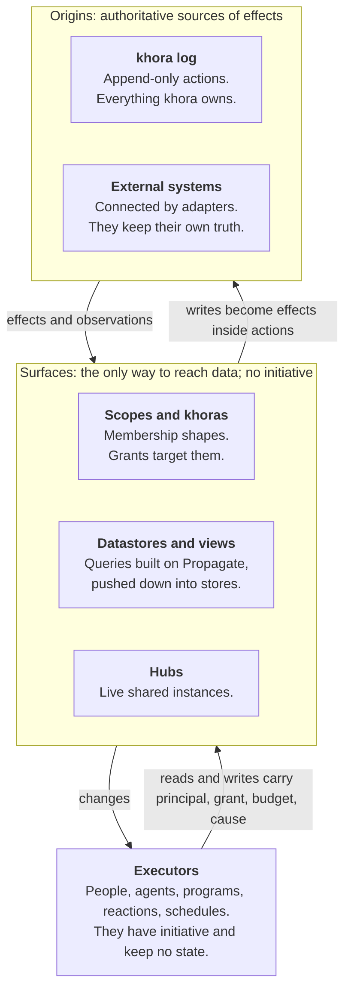

# khora: implementation plan

> **Status:** Draft for the team session
> **Date:** 12.11.2026
> **Built from:** the decision records in `docs/adr/` as of commit `fff8c6a`

## Purpose

This plan turns the eight decision records on the `adr-rewrite` branch into seven workstreams and 51 tasks the team can take. khora has no implementation code yet, seven records are still marked Proposed, and the security record is a stub.

Three kinds of statement appear below, and they carry different weight:

- **Decided:** taken from a decision record, cited as "0YB d3" (record ADR-0YB, decision 3).
- **MVP cut:** what each record's own MVP section keeps in and leaves for later.
- ***Suggestion*:** proposed in this plan, not decided in any record. The workstream split, the task list, the milestones and the first system are all suggestions for the team to change.

Two things the team should know before reading on:

- The PRD sets the launch target at Q4 2026. That is the current quarter, so the target needs a new date (see Open decisions).
- The sample system specs still use the older terms (proxies, governed actions, action layer, projections). This plan uses the current ones.

## The model

khora has three layers: origins hold the truth, surfaces give it shape, and executors act on it. ADR-0YA defines this and every other record builds on it.



One runtime runs all logic: surface logic, behaviors and code executors.

Read it top down for a write and bottom up for a read. The khora log is the only place khora stores what it owns.

Six rules from ADR-0YA constrain every component:

1. State changes only through effects. An entity has no storage of its own (d1).
2. Everything khora owns lives in its log. Every other origin is an external system (d3).
3. Surfaces are the only way to reach data, for reads and for writes (d6).
4. Rules about data are behaviors, never surface logic, so a rule holds through every surface (d5).
5. Executors keep no state. Whatever must survive is written through a surface (d8).
6. Anything a write depends on is reproducible or recorded (d9).

One write travels this path, and each step belongs to a different workstream:

1. An executor calls a surface's `write` with an operation, a condition and a context (0XY d1).
2. Stacked surfaces translate the operation downward until it is effects (0XX d8).
3. Rules are checked at commit, whichever surface the write came through (0YD d4).
4. The action is appended to the log as applied or rejected. Both are recorded (0YB d3).
5. Surfaces advance in dependency order, access labels first (0YC d4).
6. Confirmation or rejection reaches the caller through the surface's changes (0XY d8).

## What we build

The decision records describe eight components. Each row gives what the component does, what its record keeps in the MVP, and what waits.

| Component | What it does | In the MVP | Later | Record, issue |
| --- | --- | --- | --- | --- |
| **Log** | Append-only, totally ordered actions in a causal hash graph. Two times per action. Payloads stored once by hash and encrypted per key. | Decisions 1–7 and 10. Branches for unconfirmed writes only. | Plans, offline edits and agent branches. Snapshots of external content. | 0YB, #4 |
| **Surface contract** | One contract for every surface: `declares`, `read`, `write`, `changes`. Reads at a frontier, conditional writes, upcasters, materialization. | Decisions 1–8 and 10, with two or three datastores. | Conflict resolution beyond merge rules. | 0XY, #1 |
| **Adapters** | Connect an external system as an origin: its changes become effects, writes become its own operations. | The first external system a domain needs. | More systems. | 0XY d9 |
| **Surface logic** | `Query` as data: an envelope and a tree of operators, with `Propagate` as the general one. Named algebras, merge rules, annotations. | Decisions 1–5 and 7–9. Incremental upkeep for rings only. | Other algebras kept live. The algorithm library. Text syntax. | 0XX, #1 |
| **Runtime** | Runs all logic. Compiles declarative logic and pushes it into datastores. Scheduling classes, dependency-order advance, lazy time. | Declarative logic only. | The sandbox for opaque code (lean: WASM). | 0YC d1–5, #9 |
| **Executors and hubs** | API for people and outside agents. Standing executors with leases, at-least-once triggers and budgets. Hubs as live shared surfaces. | Reactions and schedules written in code. Hubs as simple shared rooms. Agents through the API. | The agent runner. | 0YC d6–10, #9 |
| **Behaviors and processes** | Logic bound to a kind or an entity, defined as data. Rules checked at commit. Processes as composed behaviors whose instances are entities. | Derived and invoked behaviors, rules, processes with internal and external actions, child processes and waits. | Agent parts. Parallel composition. | 0YD, #2 and #7 |
| **Scopes, rights and access** | Scopes as membership surfaces. Rights by grant, no owners. Access labels enforced by the runtime and explainable. | Decisions 1–20, with declared, defined and structural membership. | Detected membership. Identity and distribution across deployments (d21–22). | 0XZ, #6 |

The security record (0YE) is a stub. It lists what the others already commit to and leaves authentication, secrets, trust boundaries, abuse limits and the threat model to design.

## Shared contracts

Three shapes are shared by every workstream, so they are fixed first and changed only together. They are copied from the records.

**The action** (0YB d3) is what the log stores and what every surface is built from:

```
Action { id: hash, log, causes: [ActionId],
         occurred, recorded, vocabulary,
         actor, on_behalf_of, grant, via,
         outcome: applied | rejected(reason) | pending,
         effects: [Effect] }
Effect = Attr   { entity, attribute, old, new }
       | Rel    { relation, from, to, +/- }
       | Member { scope, entity, +/- }
       | Kind   { entity, old, new }
```

**The surface contract** (0XY d1) is how anything reaches data:

```
Surface {
  declares(): Declaration
  read(request, ctx): Result
  write?(operation, condition, ctx): Unconfirmed | Rejected
  changes?(since): Stream<Change>
}
ctx = { principal, grant, budget, cause }
```

**The query** (0XX d2 and d4) is the declarative logic surfaces and behaviors carry:

```
Query { body: Operator,
        time: { frontier, by: recorded | occurred, meaning: then | now },
        annotations, semantics: set | multiset, return, order, page }
Propagate { seed, over, algebra, update?,
            until: steps(n) | hops{min,max} | fixpoint | converged(e),
            emit:  final | per-step | paths }
```

Every component also holds these rules, whichever workstream builds it:

- **Every call is attributable.** Reads and writes carry the same context (0XY d1).
- **Every read happens at a frontier,** and its result states completeness, the frontier seen and its annotations (0XY d1, d4).
- **Every write is conditional on what it read.** A failed condition is rejected and recorded, unless a merge rule applies (0XY d7).
- **Effects are invertible,** so undo, incremental upkeep and conflict detection share one format (0YB d4).
- **Nothing is delivered before access labels reach its frontier** (0YC d4).
- **A write runs with the caller's rights intersected with the surface's grants,** never the surface's alone (0XZ d16).
- **Restrictions travel.** A derived value is readable only by those who may read all its inputs (0XZ d17).
- **A datastore never silently drops part of a request.** It answers exact, inexact or unsupported (0XY d3).
- **Nondeterministic output is recorded before a write uses it** (0YA d9).

## Milestones

*Suggestion.* Four milestones, each ending in something that runs. None has a date, because the team's capacity is not stated anywhere in the repo.

| Milestone | What runs at the end | PRD P0 it covers | Gate to pass |
| --- | --- | --- | --- |
| **M0 Foundations** | The shared contracts as types in the chosen language. A log prototype with measurements. | None yet | Language chosen. Log store chosen from the issue #4 measurements. |
| **M1 Walking skeleton** | A write through the API becomes an action in the log. A state surface answers reads at a frontier, one entity's history, and who did what. A write is undone by its inverse. | Provenance, Computations | The issue #4 queries pass. Surface contract tests pass for one datastore. |
| **M2 Structure and rules** | Scopes, grants and access labels. Kinds, rules at commit, derived and invoked behaviors. Queries with `Propagate` across two datastores. | Scoping, Modeling (in part) | The issue #6 access tests pass. A rule holds through two different surfaces. |
| **M3 First system** | One sample system end to end: an adapter syncs an external source, queries answer real questions, a process with a wait and an approval writes back. | Interoperability | The system's own query suite and log replay pass. |

*Suggestion:* use the **furniture workshop** as the first system. Three reasons:

- The records already test against it: the log's done-when includes its 100 000-project import (R19), and the process example is `QuoteFromHistory`.
- It has a real first source (Kroika project files) and a named pilot path: the Kroika author's projects, then one workshop.
- It exercises the adapter, the mapping into child entities, scoped access per plant, and write-back with approval.

Nutrition optimization is the smaller alternative. It needs no multi-party access, so it would leave the rights work untested.

**PRD P0 Interaction has no decision record.** It asks for representations people use instead of raw entities, and data that feels alive. Hubs cover the live part. Nothing in the records covers what a person sees, so no milestone above delivers it.

## Workstreams and tasks

*Suggestion.* Seven workstreams, A to G, one per component group plus the first system. "Done when" comes from each record's own done-when list where one exists. "Needs" lists the tasks that must land first. The Owner column is empty for the team to fill.

### A. Log (0YB, issue #4)

| ID | Task | Done when | Needs | Milestone | Owner |
| --- | --- | --- | --- | --- | --- |
| A1 | Action and effect types, content-hash ids over causes, hybrid logical clock | An action round-trips. A frontier that includes an action without its causes is refused. |  | M0 |  |
| A2 | Log store prototype on the three candidates: Redpanda or Kafka, NATS JetStream, an embedded log on object storage | The five issue #4 measurements exist for each candidate | A1 | M0 |  |
| A3 | Append path with total order and the three outcomes: applied, rejected, pending | A rejected attempt appears in the log as an action | A2 | M1 |  |
| A4 | Payload store: content by hash, encrypted per key, shredded by deleting the key | Deleting a key removes the content. Id, causes and actor remain. | A1 | M1 |  |
| A5 | Bulk write as one action with one payload | A 100 000-project import is one action, and its entities are addressable inside the batch | A3, A4 | M1 |  |
| A6 | Branches for unconfirmed writes | A read on a branch sees its base up to the fork plus its own actions. A merge appends conditional actions. | A3 | M2 |  |

### B. Surfaces and datastores (0XY, issue #1)

| ID | Task | Done when | Needs | Milestone | Owner |
| --- | --- | --- | --- | --- | --- |
| B1 | Surface contract, declaration and context as types | A stub surface implements them |  | M0 |  |
| B2 | Contract test suite any surface can run | It covers the base contract, each declared capability, conditional writes, upcasting and past reads | B1 | M1 |  |
| B3 | State datastore: entities and relations materialized from the log | It passes B2. A rebuild from a snapshot equals a rebuild from the start of the log. | A3, B1 | M1 |  |
| B4 | Frontiers and past reads, by recorded or occurred time | A read at a later frontier waits or returns partial. A past read sees old data, definitions and kinds. | B3 | M1 |  |
| B5 | Conditional writes with asynchronous commit | A failed condition is rejected and recorded. Confirmation arrives through `changes`. | A6, B3 | M2 |  |
| B6 | Vocabulary versions and upcasters | An old effect reads both as it was and with today's meaning. An effect with no upcaster path is marked. | B4 | M2 |  |
| B7 | A second datastore with a declared capability, such as search or time series | It answers exact, inexact or unsupported per operation | B1, B2 | M2 |  |
| B8 | Adapter framework | External changes become observed effects. A write stays pending until observed. Contradicting values are both kept and flagged. | B5 | M3 |  |

### C. Surface logic and planner (0XX, 0YC d1)

| ID | Task | Done when | Needs | Milestone | Owner |
| --- | --- | --- | --- | --- | --- |
| C1 | `Query` as a data structure, with validation | A query is stored and versioned. A malformed one is refused. |  | M0 |  |
| C2 | `Scan`, `Filter`, `Aggregate` and `Not` on the state datastore | Reads in the M1 demo run as queries | B3, C1 | M1 |  |
| C3 | `Propagate` with all four stop conditions, in a generic loop | A join runs as `steps(1)`. Reachability runs to `fixpoint`. | C2 | M2 |  |
| C4 | The seven named algebras, each declaring its properties | An optimization applies only when the algebra declares the property it needs | C3 | M2 |  |
| C5 | Merge rules as algebras on concurrent writes | Counters add and sets unite. An attribute without a rule conflicts. | C4, B5 | M2 |  |
| C6 | Annotations as columns: confidence and age by default | A constant confidence of 1 drops out of the plan | C3 | M2 |  |
| C7 | Planner and pushdown across two datastores | Each pushdown fallback returns the same result as native execution | B7, C3 | M2 |  |
| C8 | Incremental upkeep for ring algebras. Evaluate DBSP/Feldera and Differential Dataflow first. | A materialized surface equals a recompute after inserts and deletes | C4, B3 | M2 |  |

### D. Scopes, rights and access (0XZ, issue #6; 0YE)

| ID | Task | Done when | Needs | Milestone | Owner |
| --- | --- | --- | --- | --- | --- |
| D1 | Principals, the rights bundle, and grants as entities | A creator holds all rights. Nobody can grant more than they hold. | A1 | M2 |  |
| D2 | Scopes with declared, defined and structural membership, nesting and overlapping | A relation belongs to a scope when both its ends do | B3, C2 | M2 |  |
| D3 | Access labels as a kernel surface, pushed down as filters | Everything is private by default. A relation is visible only if both ends are. | D1, D2 | M2 |  |
| D4 | Revocation, cascading through delegated grants | A revocation reaches the labels before any later read is served | D3 | M2 |  |
| D5 | Write authority as an intersection, with `on_behalf_of` taken from the grant used | A write through a surface never exceeds the caller's own rights | D1, B5 | M2 |  |
| D6 | Restrictions on derived values, and partial aggregates | A derived value is hidden from anyone who cannot read all its inputs. An aggregate over hidden members is marked partial. | D3, C3 | M2 |  |
| D7 | Approval for irreversible, external and untrusted-caused writes, and recorded reads | Such a write waits for a holder's approval. A read in a recording scope is in the log. | D5 | M3 |  |
| D8 | Explain access | For any principal and right, the grant chain is shown, or the reason none exists | D3 | M2 |  |
| D9 | Authentication at the API and hub boundary. Not designed yet: 0YE is a stub. | A short design is agreed, then implemented |  | M1 |  |

### E. Behaviors and processes (0YD, issues #2 and #7)

| ID | Task | Done when | Needs | Milestone | Owner |
| --- | --- | --- | --- | --- | --- |
| E1 | Kinds, and behaviors bound to a kind or to one entity, stored as data | An entity-bound behavior overrides its kind's | A1, F3 | M2 |  |
| E2 | Derived and invoked behaviors inside surfaces, each with its declaration | An undeclared behavior reports impact as unknown, never as unaffected | E1, C2 | M2 |  |
| E3 | Rules checked at commit | A rule holds whichever surface a write comes through | E1, B5 | M2 |  |
| E4 | Behavior versions | A new rule flags violating entities without rewriting them. A read at an earlier frontier uses the earlier version. | E3, B4 | M2 |  |
| E5 | Process composition: sequence, choice, wait and child process, with internal and external actions | A pure process runs inside surface logic | E2 | M3 |  |
| E6 | Process instances as entities built from their actions | An instance resumes after a restart without repeating work. A wait holds no resources. It stops when its starter's authority ends. | E5, D4 | M3 |  |
| E7 | Compensation from invertible effects | A failure across two origins is compensated | E6, B8 | M3 |  |

### F. Runtime, executors and API (0YC, issue #9)

| ID | Task | Done when | Needs | Milestone | Owner |
| --- | --- | --- | --- | --- | --- |
| F1 | Runtime skeleton: three scheduling classes, surfaces advancing in dependency order | Slow executor work does not delay label upkeep | B3 | M1 |  |
| F2 | API for people and outside agents: read, write and changes | The M1 demo runs through it | B1, D9 | M1 |  |
| F3 | Definitions catalog and boot. Open question in 0YA. | khora starts from vocabulary, behavior and surface definitions held in its own log | A3, B3 | M2 |  |
| F4 | Standing executors: reactions and schedules in code, each held as a lease | A trigger delivered twice changes nothing. Revoking the grant stops the executor. | F1, D4 | M3 |  |
| F5 | Budgets along chains of causes | A chain that exhausts its budget stops and is flagged | F4 | M3 |  |
| F6 | Lazy time: decay and staleness computed on read, with threshold timers | Nothing ticks per entity | F1, C6 | M3 |  |
| F7 | Hubs as simple shared rooms | Each participant receives only what they may read | F2, D3 | M3 |  |

### G. First system: furniture workshop slice

| ID | Task | Done when | Needs | Milestone | Owner |
| --- | --- | --- | --- | --- | --- |
| G1 | Update the spec to the current terms. Listed as a follow-up in `CLAUDE.md`. | No proxies, governed actions or action layer remain in the spec |  | M0 |  |
| G2 | Vocabulary: kinds for project, piece, panel, material and plant | The kinds load through the catalog | E1 | M3 |  |
| G3 | Kroika adapter for project files, and the mapper into child entities | Spec R1 and R4 tests pass | B8, G2 | M3 |  |
| G4 | Query suite and first-sync load test on a generated corpus | Spec R7 passes. R19 is measured. | G3, C7 | M3 |  |
| G5 | Plants as scopes | Spec R14 and R21 access tests pass | G3, D3 | M3 |  |
| G6 | `QuoteFromHistory` without its agent part, and assembling a new project with approval and write-back | Spec R9 passes. The new project opens in Kroika. | E6, D7 | M3 |  |

## Sequencing

The log and the state datastore gate almost everything, so they get people first. Ten tasks form the longest chain, and it ends at the quote process.

| Workstream | M0 Foundations | M1 Walking skeleton | M2 Structure and rules | M3 First system |
| --- | --- | --- | --- | --- |
| A. Log | **A1, A2** | **A3**, A4, A5 | A6 | |
| B. Surfaces and datastores | B1 | B2, **B3**, B4 | B5, B6, B7 | B8 |
| C. Surface logic and planner | C1 | C2 | C3 to C8 | |
| D. Scopes, rights and access | | D9 | D1 to D6, D8 | D7 |
| E. Behaviors and processes | | | **E1, E2**, E3, E4 | **E5, E6**, E7 |
| F. Runtime, executors and API | | F1, F2 | **F3** | F4 to F7 |
| G. First system | G1 | | | G2 to G5, **G6** |

Tasks in bold are on the longest chain.

Each row is a workstream and each column a milestone. Cells in the same column can run in parallel once their "Needs" are met.

- **Day one, in parallel:** A1, B1, C1, G1, and the design for D9. None of them needs another task.
- **The longest chain:** A1 → A2 → A3 → B3 → F3 → E1 → E2 → E5 → E6 → G6. A delay on any of these delays M3.
- **The widest fan-out:** B3, the state datastore. Seven tasks across four workstreams need it directly.
- **The quiet blocker:** F3, the definitions catalog. Behaviors cannot be stored as data until it exists, and 0YA leaves its design open.
- **M2 is the heaviest milestone,** with 22 of the 51 tasks. Logic (C) and rights (D) can go to different people: rights needs logic only for D2 and D6.

## Open decisions

Thirteen decisions are open. The first four block M0 and belong in the team session.

| Decision | Lean in the records | Blocks | Needed by |
| --- | --- | --- | --- |
| **Implementation language** | None stated. The planner lean depends on it: DataFusion if Rust, Calcite if JVM (0YC). | Every task | M0 |
| **Log store** | Measure Redpanda or Kafka, NATS JetStream, and an embedded log on object storage (0YB) | A2, A3 | M0 |
| **Accept the records** | All seven are Proposed and unnumbered. The model record says every other builds on it. | Shared contracts | M0 |
| **First system** | None stated. *Suggestion:* furniture workshop. | Workstream G | M0 |
| **Which two or three datastores** | Not named. 0XY lists the capabilities: traversal, search, spatial, time series, valid time. | B3, B7 | M1 |
| **Authentication** | To design (0YE stub) | D9, F2 | M1 |
| **Definitions catalog and boot** | Open: a named catalog surface, or ordinary surfaces over definition effects (0YA) | F3, E1 | M2 |
| **Incremental engine** | Adopt rather than build: DBSP/Feldera or Differential Dataflow (0XX) | C8 | M2 |
| **Key granularity for encryption** | Per entity, or per holder and scope. Decide with security (0YB). | A4 | M1 |
| **Upper ontology** | No record covers it. PRD P0 Modeling asks for a complete structural ontology kernel. | G2, and Modeling in full | M2 |
| **Interaction layer** | No record covers it. PRD P0 Interaction. | What people see at M3 | M3 |
| **Launch target** | The PRD says Q4 2026, with no code written yet | Planning | M0 |
| **License** | Open source is intended. The license is not chosen. | First public commit of code | M0 |

These are open in the records but do not block the MVP: the sandbox (lean: WASM), rebasing long-lived branches, conflict resolution beyond merge rules, how a khora's field is defined, whether the existence of hidden entities is protected, the process definition syntax, and everything marked **(interop: review)**.

## Sources

Everything above marked as decided comes from this repository at commit `fff8c6a` (branch `adr-rewrite`), read on 12 November 2026. Issue numbers are as cited inside the records; the issues themselves were not read.

| Record | File |
| --- | --- |
| ADR-0YA, the model | [origins-behaviors-surfaces-executors.md](adr/origins-behaviors-surfaces-executors.md) |
| ADR-0YB, the log | [khora-log.md](adr/khora-log.md) |
| ADR-0XY, surfaces | [surfaces.md](adr/surfaces.md) |
| ADR-0XX, surface logic | [surface-logic.md](adr/surface-logic.md) |
| ADR-0XZ, scopes, khoras and rights | [scopes-khoras-and-rights.md](adr/scopes-khoras-and-rights.md) |
| ADR-0YC, runtime and executors | [runtime-and-executors.md](adr/runtime-and-executors.md) |
| ADR-0YD, behaviors and processes | [behaviors-and-processes.md](adr/behaviors-and-processes.md) |
| ADR-0YE, security model (stub) | [security-model.md](adr/security-model.md) |
| Product requirements | [PRD.md](PRD.md) |
| Furniture workshop spec | [furniture-workshop.md](systems/furniture-workshop.md) |
| Conventions and follow-ups | [CLAUDE.md](../CLAUDE.md) |
