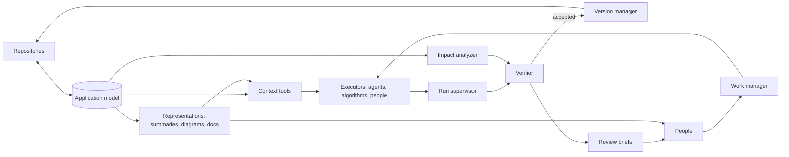

> **Status:** Sample spec. It shows the main functionalities such a system needs; it is not complete. Points marked **(interop: review)** depend on interoperability between khoras. Points marked *Suggestion* are proposals that have not been decided.
 
## 1. Overview
 
- **System name:** Application development
- **Purpose:** Holds an application's data, logic, processes and interfaces as a model in the khora, and develops it through that model. It is the foundation for effective, efficient agent-based development: agents, algorithms and people get the information and tools a task needs, work within declared bounds, and are verified on evidence rather than on their own reports. The long-term target is developing khora itself.
- **Scope:**
  - **In:**
    - **Application model:** requirements, features, components, data, logic, flows and interfaces as entities. Specs written in the template are data too.
    - **Work management:** the project's work as tasks, held in a project khora that can interoperate with company khoras. **(interop: review)**
    - **Agent-based development:** context for tasks, scoped runs and independent verification.
    - **Representations:** flows, diagrams, docs and feature overviews generated from the model.
    - **Version management** with checkpoints.
    - **Automated actions.**
    - **Blast radius** of changes.
    - **Testing:** end-to-end, load and penetration, among others.
    - **Interface workshop** for static and dynamic interfaces.
  - **Out:**
    - The agents and models themselves. They are consumers of the system.
    - Hosting code. Repositories stay the system of record in the first release.
    - Production operation.
- **Stakeholders:**
  - Executors: AI agents, algorithms and developers.
  - Product owners and designers.
  - Reviewers and testers.
  - Consumers of the application's interfaces, including other khoras.
  - Company khoras that take part in the project.
- **Success criteria:**
  - khora is developed through the system, mostly by agents.
  - Agents get the context they need without hand-written briefs.
  - No claim of completion is accepted without evidence.
  - Diagrams and docs never go stale, because they are generated from the model.
  - A change's impact is known before it is accepted.
## 2. Context and boundaries
 
| Element | Description | Source / destination |
| --- | --- | --- |
| Inputs | Requirements, specs, tasks, decisions | People and agents |
| Inputs | Code and interface definitions | Repositories, as proxies |
| Inputs | Run traces, test results, runtime usage | Executors, test runners, environments |
| Outputs | Context and task verdicts | Executors |
| Outputs | Representations and review briefs | People and agents |
| Outputs | Generated code, clients, schemas, docs | Repositories |
| Outputs | Impact reports and interface versions | Reviewers, consumers, other khoras **(interop: review)** |
| External interfaces | Coding agents and their harnesses | khora API, e.g. through MCP |
| External interfaces | Company khoras | khora interoperability **(interop: review)** |
| External interfaces | Git hosts, CI, test tools, environments | Sync, API |
 
The system boundary is:
- **Inside:** the application model, the project's work, runs, checkpoints, tests and interfaces.
- **Outside:** the content of code, the executors themselves, build and runtime execution.
## 3. Requirements
 
| ID | Type | Requirement | Priority | Verification |
| --- | --- | --- | --- | --- |
| R1 | Functional | The system shall hold an application as a model, sync its repositories as proxies with their structure extracted, and let each element be code-first or model-first, flagging drift between the two. | Must | Test: a manual edit to generated code raises drift |
| R2 | Functional | The system shall trace any element in both directions from requirement to task, code, interface and test. | Must | Test query suite |
| R3 | Functional | The system shall give executors the context for a task, either assembled for them or, in some cases, by letting them assemble it themselves: through recipes, or through aggregated views of the project's state (computed summaries, diagrams, docs) from which they discover further context. | Must | Replayed tasks completed with the provided context |
| R4 | Functional | The system shall manage the project's work as tasks with intent, constraints, a definition of done and a write scope, and hold back underspecified tasks instead of letting an executor guess. | Must | Test: a task without acceptance checks is not dispatched |
| R5 | Functional | The system shall compute the blast radius of a change across code, data, interfaces, tests, docs and consumers, and use it to select tests, size reviews and notify consumers. **(interop: review)** | Must | Replayed changes: predicted against actual breakage |
| R6 | Functional | The system shall run executors in sandboxes created from a checkpoint, enforce their write scope, and require approval for irreversible actions. It shall not rely on the sandbox alone: executors get least-privilege, short-lived credentials, and runs are monitored for attempts to leave the sandbox. | Must | Red-team tests: escape attempts are contained and detected |
| R7 | Functional | The system shall accept a run's result only on checks it runs itself, protect tests from being edited or gamed by the executor, and flag duplicated code. | Must | Tasks whose tests contradict the spec are rejected |
| R8 | Functional | The system shall generate flows, diagrams, docs, feature overviews and review briefs from the model, for people and as compressed views for agents, and write edits made in them back to the model. | Must | Test: a model change updates every affected representation |
| R9 | Functional | The system shall create checkpoints across model, code, schemas and configuration, diff them by entity, and restore or branch from any of them. | Must | Test on a reference history |
| R10 | Functional | The system shall run automated actions on triggers, as governed actions, with approval when the impact is large or the action irreversible. | Must | Test: a large-impact action waits for approval |
| R11 | Functional | The system shall derive end-to-end tests from user flows and contract tests from interfaces, run load tests from workload models, and run penetration tests only against authorized targets. | Must | Reference applications |
| R12 | Functional | The system shall let interfaces be defined, mocked and reviewed before implementation, either static (fixed, versioned contracts) or dynamic (composed at request time from the model and the consumer's scope), and flag breaking changes against consumers. | Must | Compatibility suite |
| R13 | Performance | *Provisional:* context for a typical task within [5 s]; blast radius of a typical change within [10 s]. | Should | Load tests, once targets are set |
| R14 | Security | Access is scope-based for every principal, executors included. Secrets never appear in context, logs or diffs. | Must | Access tests, audit |
 
## 4. Architecture
 
- **Components:**
  - **Application model:** the ontology for applications, and code structure extracted from repositories.
  - **Context tools:** assembled context, recipes, and access to aggregated views of the project's state.
  - **Work manager:** the project's tasks, and dispatch to executors.
  - **Run supervisor:** runs executors in sandboxes, enforces scope and monitors runs.
  - **Verifier:** checks results on its own evidence.
  - **Impact analyzer:** computes blast radius.
  - **Representation engine:** generates flows, diagrams, docs, summaries and review briefs.
  - **Version manager:** checkpoints, diffs, restore.
  - **Test manager:** derives, selects and runs tests.
  - **Interface workshop:** defines, mocks and checks interfaces.
- **Interactions:**

 
- **Data:** Feature, Requirement, Component, Interface, Flow, CodeUnit, Task, Run, Recipe, Checkpoint, Test.
- **Behavior:**
  - **The loop:** specify a task → provide context → dispatch → run → verify → review → checkpoint.
  - **Bootstrap for khora:**
    1. Overlay on khora's repositories, with agents working through the system's context tools.
    2. Interfaces and data models move to model-first.
    3. Logic is modeled and run by khora's process runtime.
  - **Failure handling:**
    - A run that leaves its write scope is stopped and rolled back.
    - A detected escape attempt stops the run and revokes its credentials.
    - A run whose claims contradict the evidence is rejected.
    - Missing dependency data makes an impact "unknown", never "unaffected".
- **Depends on khora:** proxies, governed actions, the action log, the process runtime, principals and scopes, and interoperability between project and company khoras **(interop: review)**.
## 5. Constraints, assumptions and risks
 
- **Constraints:**
  - The system is meant to develop khora but depends on its kernel, so it takes over in stages.
  - Models and agents change every few weeks. The system measures them rather than assuming their behavior.
  - A sandbox cannot be assumed to hold against a capable agent.
- **Assumptions:**
  - Much of what makes agent work fail (missing context, vague tasks, unbounded scope, weak verification) can be addressed by the system around the agent.
- **Risks:**
| Risk | Impact | Mitigation |
| --- | --- | --- |
| Agents escape the sandbox | High | Defense in depth: isolation below the process level, least-privilege short-lived credentials, restricted network access, no secrets in the sandbox, monitoring, governed actions for everything outside |
| Context misses something critical | High | Agents can discover further context from aggregated views of the project's state |
| Agents game tests or claim false success | High | System-run checks only, protected tests |
| Agents take destructive actions | High | Write scope, approvals, rollback |
| Agent-written code piles up duplication | Medium | Duplication checks |
 
## 6. Verification
 
- **Dogfooding:** develop khora through the system.
- **Context benchmark:** agents with the system's context tools against the same agents searching on their own, on success, cost and tool calls.
- **Impact replay:** predicted blast radius against what actually broke in past changes.
- **Gaming suite:** tasks whose tests contradict the spec; every gamed result must be rejected.
- **Sandbox red-teaming:** agents instructed to escape; every attempt must be contained and detected.
## 7. Open questions
 
- [ ] When is context assembled for an agent, and when does the agent assemble it?
- [ ] What does a recipe contain, and who writes it?
- [ ] Which aggregated views of the project's state do agents need first?
- [ ] Who writes definitions of done: people, or agents with approval?
- [ ] Which changes still need human review as trust in agents grows?
- [ ] How does the project khora's work relate to the work views of the company khoras taking part?
- [ ] Checkpoints and git: does the model eventually own versioning?
- [ ] What can a dynamic interface guarantee its consumers?
- [ ] *Suggestion:* include existing elements that could be reused in a task's context, to counter duplication in agent-written code.
- [ ] *Suggestion:* name what context could not be determined, so agents know where to look further.
- [ ] *Suggestion:* record which context agents actually used, to improve recipes over time.
## Considerations: processes
 
> Discussion notes, not decisions. They record how processes could work in this system, for review.
 
Processes are a core feature of khora, and this system works with them on two levels:
- **Development processes:** developing, testing, reviewing, releasing. They act on the application.
- **Application processes:** what the code itself runs, such as a query. Ideally these later run in khora itself, following its language and rules.
**One construct for both levels.** If both levels are khora processes, development processes take application processes as their data. Testing a query is a process that runs another process against a checkpoint. Reviewing a change is a process over the diff between two process versions. Eventually the development processes develop themselves, which is the self-containment target of the PRD. The previous, trusted version of a development process is always the one that produces and checks the next.
 
**From described to native.** Code-first and model-first could extend into three stages for processes:
1. **Described:** the process model is extracted from code. Useful for diagrams and impact, but it can drift.
2. **Specified:** the model is authoritative and code is generated from it.
3. **Native:** the process runs in khora's runtime. The model is the program, so drift disappears.
Queries are good first candidates for native processes: mostly declarative and read-only. Running them natively also answers the PRD's open question on cross-datastore queries. Writes come later, since they need effects, transactions and governed actions.
 
**What native processes give this system:**
- **Exact blast radius:** a native process declares what it reads and writes through scopes, so its impact is known rather than inferred. Accuracy grows as processes move into khora.
- **Flows as views:** a data flow is a view of a process, and a user flow is a process with human steps.
- **Testing material:** test paths derived from process structure, simulation against a checkpoint before code exists, load models from steps and their datastores.
- **Interfaces as process boundaries:** a dynamic interface is a process composed at request time.
- **khora's rules apply:** scopes, governed actions and the action log cover every native process, so provenance and replay come built in.
- **Executors as performers of steps:** a development task is a step in a development process instance, and the same step can be performed by an agent, an algorithm or a person.
**Tensions:**
- **Expressiveness against analyzability:** a fully general process language makes impact and verification undecidable in general. A possible answer is a declarative core for queries, transformations and flows, plus explicitly opaque steps that call code, so the runtime knows where its knowledge ends.
- **Semantic home against execution substrate:** interpreting processes over virtual entities may be too slow for hot paths. khora could own a process's definition and meaning while compiling it to code underneath.
- **Granularity:** model where meaning lives (data access, business rules, flows, integrations) and leave algorithms as opaque steps.
- **Timescales:** a query runs in milliseconds; a development workflow runs for weeks with people in it. Long-running instances need an answer for what happens when their process gets a new version. Durable-execution models, which record each step's result, fit khora's action log.
- **Replay:** deterministic steps can be re-run; agent steps and external calls need their outputs recorded.
**Questions:**
- [ ] Is a query a process, the definition of a computed entity, or both, with a computed entity being the output of a process?
- [ ] Does the process runtime interpret process models directly, or compile them?
- [ ] Is there one process construct across all timescales, or a kernel primitive with long-running workflows built on top?