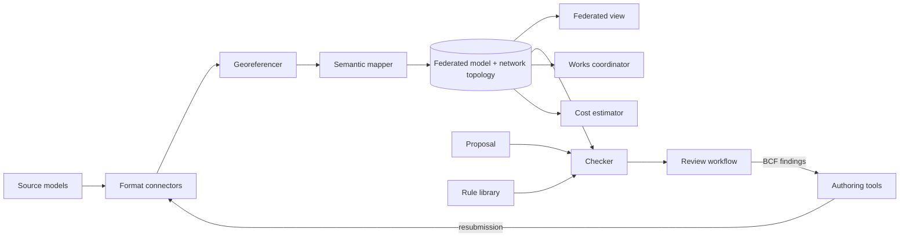

## 1. Overview
 
- **System name:** Built-environment review
- **Purpose:** Brings heterogeneous building, civil and infrastructure models into one shared spatial and semantic frame, and runs reviews over them. Proposed changes to the built environment are checked, corrected and decided quickly and traceably.
- **Scope:**
  - **In:**
    - Federation of design, context and network models as synced proxies, viewed and queried in one place.
    - Network topology.
    - Asset lifecycle over time.
    - Cost.
    - Versioned rules and automated checks.
    - Review rounds for design coordination, building permits, excavation/works permits and inspections.
    - Coordination of planned works.
  - **Out:**
    - Model authoring.
    - Asset operation and maintenance.
    - Condition monitoring, sensor data and 311 intake.
    - Capacity analysis.
    - Fees and payments.
    - Issuing legal decisions.
    - The content of any jurisdiction's codes.
- **Stakeholders:**
  - Applicants: architects, engineers, developers, contractors.
  - Reviewers and inspectors: permitting authorities, municipal departments.
  - Infrastructure owners and operators: utilities, road and rail authorities.
  - Planners.
  - The public, as a records audience.
- **Success criteria:**
  - Models from all supported formats for one site open together in one view, with no manual conversion.
  - Most computable rule checks run automatically.
  - Review rounds per application and time to decision fall against the baseline.
  - Every finding and decision traces to a rule clause, a model revision and a person.
## 2. Context and boundaries
 
| Element | Description | Source / destination |
| --- | --- | --- |
| Inputs | Design models: IFC, DWG/DXF, Revit via IFC export, PDF plan sets | Applicants |
| Inputs | Context models: cadastre, zoning plans, GIS layers, CityGML/CityJSON, utility and transport networks, LandXML / IFC 4.3, point clouds | Authorities, operators, surveys |
| Inputs | Rules: building codes, zoning regulations, clearance and works standards | Jurisdictions, operators |
| Inputs | Unit costs and cost references | Owners, cost databases |
| Outputs | Federated views and cross-model query results | Applicants, reviewers, operators |
| Outputs | Findings, correction requests and decisions | Applicants (in-system and BCF), public record |
| Outputs | Works conflicts and schedules | Operators, authorities |
| Outputs | Cost estimates for proposals and works | Owners, planners |
| External interfaces | Authoring tools | File sync, BCF round-trip |
| External interfaces | GIS and cadastral services | OGC APIs, WMS/WFS, file export |
| External interfaces | Operator network systems | API / export |
| External interfaces | AI agents (plan extraction, rule drafting, triage, letters) | khora API |
 
The system boundary is:
- **Inside:** references to the source models and their semantics, the rules, and the full review and works state.
- **Outside:** where models are authored, assets are operated and decisions are legally issued.
## 3. Requirements
 
| ID | Type | Requirement | Priority | Verification |
| --- | --- | --- | --- | --- |
| R1 | Functional | The system shall ingest and stay synced with models in all input formats as proxy entities, without converting the source. | Must | Test: one site's IFC, DWG, GeoPackage, CityJSON and PDF set open in one view; a source edit appears after sync |
| R2 | Functional | The system shall place every model in one project coordinate reference system and record the alignment uncertainty of each model. | Must | Test against surveyed control points |
| R3 | Functional | The system shall map native classes and properties to a shared built-environment ontology, flagging unmapped content instead of dropping it. | Must | Inspection of mapping reports |
| R4 | Functional | The system shall answer queries across models by location, type, attribute and connectivity (e.g. "network segments within 1.5 m of this foundation"). | Must | Test query suite |
| R5 | Functional | The system shall model networks as typed topology and trace upstream, downstream and cross-network dependencies. | Must | Test on reference networks |
| R6 | Functional | The system shall record the lifecycle state of assets (planned, under construction, in service, decommissioned) with valid and record time, and show the built environment at any date, including future planned states. | Must | Test: reconstruct past and planned states |
| R7 | Functional | The system shall hold rules as data with jurisdiction, effective dates, source clause and checkability class (computable, partial, human-only). | Must | Inspection |
| R8 | Functional | The system shall check a proposal against its context under the rules in force at submission, producing findings of pass, fail, needs review or cannot evaluate. | Must | Replay of past applications with known outcomes |
| R9 | Functional | The system shall run review rounds (findings, responses, resubmission), re-check only changed elements, and exchange findings as BCF. | Must | Test: round-trip with an authoring tool |
| R10 | Functional | The system shall detect conflicts between planned works in the same place and time window, including moratorium rules. | Should | Test scenarios |
| R11 | Functional | The system shall estimate the cost of proposals and works from element quantities, and compare bundled versus separate works. | Should | Comparison with actual costs |
| R12 | Functional | The system shall extract elements and dimensions from PDF plan sets with a confidence score, routing low-confidence extractions to a person. | Should | Precision/recall on a labelled set |
| R13 | Performance | Federated view of a site context ([50] models, [1 km²]) opens within [10 s]; an automated check of a typical application completes within [5 min]. | Must | Load tests (targets provisional) |
| R14 | Reliability | Any past review state is reconstructable from the action log; no finding or decision is lost. | Must | Log replay |
| R15 | Security | Access is scope-based. Designs are private until submitted, restricted network data is visible only to authorized parties, and decisions are public. | Must | Access tests, audit |
 
Each requirement is atomic, testable, and traceable to a stakeholder need.
 
## 4. Architecture
 
- **Components:**
  - **Format connectors:** ingest and sync each source as proxy entities.
  - **Georeferencer:** aligns models into one frame and records uncertainty.
  - **Semantic mapper:** maps native content to the shared ontology.
  - **Network model:** holds topology and dependency traversal.
  - **Federated view:** one 2D/3D/map representation, filterable by scope, discipline, level of detail and date.
  - **Rule library:** versioned, clause-linked, jurisdiction-scoped rules.
  - **Checker:** evaluates proposal + context + rules and produces findings.
  - **Review workflow:** manages rounds, responses, decisions and inspections.
  - **Works coordinator:** detects conflicts between planned works.
  - **Cost estimator:** estimates costs from quantities and unit costs.
- **Interactions:**

 
- **Data:**
  - **Entities:** Jurisdiction, Parcel, Zone, Model (source and revision), Element/Asset (geometry by level of detail, lifecycle state, owner), Connection, Network, Proposal (building, alteration, excavation, works), Rule, Check, Finding, ReviewRound, Decision, Inspection, CostItem.
  - **Where they live:** source models stay external as proxies. Rules, proposals and review state are internal. Checks, findings, conflicts and estimates are computed.
- **Behavior:**
  - **Application lifecycle:** draft → submitted → in review → corrections requested ⇄ resubmitted → approved / rejected → under construction → inspected → as-built.
  - **Failure handling:**
    - A failed sync keeps the last good revision and marks it stale.
    - Unmappable content is flagged.
    - Low-confidence extractions go to a person.
    - A check with missing context returns "cannot evaluate", never "pass".
## 5. Constraints, assumptions and risks
 
- **Constraints:**
  - Legal decisions stay with people.
  - Authoritative codes are text owned by jurisdictions.
  - Network data is often restricted critical-infrastructure data.
  - Proprietary formats are reachable only through exports or vendor SDKs.
- **Assumptions:**
  - Zoning rules are largely computable.
  - Applicants can supply at least PDF plan sets.
  - Operators will share network data under scoped access.
  - Source models carry, or can be given, a georeference.
- **Risks:**

| Risk | Impact | Mitigation |
| --- | --- | --- |
| Rule encoding errors cause false passes | High | Clause links, checkability classes, human sign-off, replay tests |
| Legacy network data has poor positional accuracy | High | Recorded uncertainty; clearance checks use uncertainty buffers |
| Reviewers distrust automated findings | Medium | Findings are advisory first; every finding is explainable |
| City-scale context is too heavy to load | Medium | Tiled level-of-detail streaming; proxies loaded on demand |
 
## 6. Verification
 
- **Replay:** run historical applications with known corrections and decisions, and measure findings precision/recall against what reviewers actually raised.
- **Interoperability suite:** standard sample files per format, including round-trips with authoring tools via BCF.
- **Georeferencing:** test against surveyed control points per model type.
- **Pilots:** one design firm (coordination use) and one permitting authority (review use), measuring rounds per application and time to decision against their baseline.
- **Log replay:** reconstruct review states and lifecycle states from the action log.
## 7. Open questions
 
- [ ] Alignment tolerance per use: design coordination vs zoning vs excavation clearance.
- [ ] Topology modeling: per-utility semantics, or a generic flow network with typed commodities.
- [ ] Is an owner attribute on assets enough, or do routing and multi-agency review need a full party/responsibility model?
- [ ] Primary user for the first release: applicant or reviewer.
- [ ] Which formats the partner firm actually juggles, and which is the worst.
- [ ] Cost estimates: indicative or bid-grade, and from which data sources.
- [ ] Performance targets in R13.
 