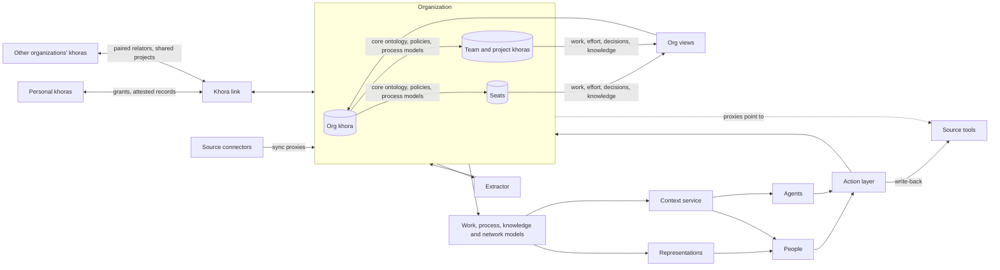

> **Status:** Draft. Points marked **(interop: review)** depend on interoperability between khoras and are to be reviewed once that functionality is designed. The definition of a khora, as opposed to a scope, is #TODO.
 
## 1. Overview
 
- **System name:** Company brain (khora for organizations)
- **Purpose:** Holds an organization's work, knowledge, relations and resources as one living model, so that people and AI agents can run any company process with complete, current context. It is an ERP and CRM in the khora format. The organization is a khora of khoras:
  - an org khora for the whole;
  - seats for its participants;
  - collectives (teams, projects) as participants in their own right.
  The organization owns all of them. Placement only decides where each thing lives.
- **Scope:**
  - **In:**
    - **The org khora:** what concerns the organization as a whole.
      - Direction: strategy, company goals, plans, policies.
      - Governance: which seats exist, reporting lines, delegated authority.
      - Contracts and obligations.
      - External relations and opportunities (company-level CRM).
      - Company-level department records: finance, legal, commercial.
      - Prescribed process models.
      - The portfolio of projects.
      - External models: competitors, markets, institutions, regulation, technologies.
      - Company-wide knowledge and decisions.
      - Org views computed across all khoras of the organization.
    - **Seats:** participant khoras the organization owns, occupied by a person or an agent.
      - Role and position.
      - The seat's work.
      - Capability beliefs and capacity.
      - Working knowledge and decisions within the seat's remit.
      - Process runs.
      - Person-to-person ties held for the organization.
    - **Collectives:** team and project khoras.
      - Shared work, decisions, knowledge, risks and sources.
      - A project khora may be shared by several organizations.
    - **Department packs:** commercial, operations, finance, people, legal. Their entities are placed by the placement rule.
    - **Metrics and performance.**
    - **The interface to personal khoras:**
      - An occupant brings past experience by linking their personal khora to a seat.
      - An occupant leaves with an attested record of their tenure.
  - **Out:**
    - Being the system of record in the first release. The brain is an overlay on existing tools.
    - Statutory accounting, payroll execution and legal filings.
    - Domain systems the company operates in. Those are content hosted alongside it.
    - The content of personal khoras, which belong to people, not to the organization.
    - Agent workflows. These are specified later.
- **Stakeholders:**
  - Management and founders.
  - Occupants of seats: employees in every department, and AI agents.
  - Project collaborators, including people from other organizations working in a shared project khora.
  - External parties (customers, partners, investors, institutions) as modeled entities, not users.
- **Success criteria:**
  - The company runs its work through the system.
  - Any question about the organization's, a seat's or a project's state can be answered, traced to evidence.
  - People and agents get the context they need without hand-fed briefs.
  - Seats, teams, departments and projects see across each other without integration work.
  - Turnover loses nothing: a new occupant takes over a seat with its work, relations and context.
  - A new department, process, project or domain is added without changing the core.
## 2. Context and boundaries
 
| Element | Description | Source / destination |
| --- | --- | --- |
| Inputs | Work artifacts: code, documents, tasks, designs | Work tools, pointed to by proxies |
| Inputs | Communications: email, chat, meetings, calendar | Communication tools, pointed to by proxies |
| Inputs | Business records: CRM, accounting, banking, HR, contracts | Business systems, pointed to by proxies |
| Inputs | External information: web, registries, filings, news, research | External sources, pointed to by proxies |
| Inputs | Work done inside khora | Seats and collectives |
| Inputs | Declared intents: goals, requirements, plans, commitments, policies | People |
| Inputs | Experience occupants bring: capability evidence, history, attested records | Personal khoras **(interop: review)** |
| Inputs | What shared project khoras and partner organizations share | Other organizations' khoras **(interop: review)** |
| Outputs | Representations: work state, views, dashboards, briefs, plans | People |
| Outputs | Scoped context for a task, entity or question | People and AI agents |
| Outputs | Core ontology, policies, process models | Seats and collectives |
| Outputs | Actions written back | Source tools |
| Outputs | Alerts: contradictions, staleness, drift, risks | Owners |
| Outputs | Attested records of tenure | Personal khoras **(interop: review)** |
| External interfaces | Source tools | Proxy sync |
| External interfaces | AI agents | khora API |
| External interfaces | Personal khoras | khora interoperability **(interop: review)** |
| External interfaces | Other organizations' khoras | khora interoperability **(interop: review)** |
 
The system boundary is:
- **Inside:**
  - The org khora, its seats and its collectives, each with its own entities, proxies, relators, claims and beliefs, decisions, processes and work.
  - The org's side of shared project khoras.
- **Outside:**
  - The content that proxies point to.
  - Personal khoras beyond what their owners grant.
  - Other organizations' khoras beyond what they share.
  - The execution of legal, statutory and payment acts.
## 3. Requirements
 
| ID | Type | Requirement | Priority | Verification |
| --- | --- | --- | --- | --- |
| R1 | Functional | The system shall hold a core organization ontology that department packs and every khora of the organization extend without modifying. | Must | Inspection: packs, seats and collectives add entities and relations only |
| R2 | Functional | The system shall align its core and department ontologies with established ontologies wherever one exists. | Should | Inspection of alignment mappings |
| R3 | Functional | The system shall place every entity by one rule: what concerns the organization as a whole lives in the org khora, and internals live in the seat or collective where they occur. The organization owns all of them. | Must | Inspection: every entity type has a placement |
| R4 | Functional | The system shall model each participant as a seat the organization owns, which can be vacant, occupied by a person or an agent, and handed over with its work, relations and context intact. | Must | Test: vacate and reoccupy a seat; nothing is lost |
| R5 | Functional | The system shall let any entity be a proxy that points to where its content is and stays in sync with it. | Must | Test: a source change is reflected after sync |
| R6 | Functional | The system shall extract entities and claims from the content proxies point to, with source and confidence, and flag what doesn't map. | Must | Inspection of extraction reports |
| R7 | Functional | The system shall model work as goals, requirements, work items and definitions of done, linked to each other and nestable at any depth, in seats and collectives alike. | Must | Inspection |
| R8 | Functional | The system shall infer the state of work (what, who, toward which goal, how close to done) from evidence and match it against declared work. | Must | Test: inferred work state against a labelled period |
| R9 | Functional | The system shall support distributing work across seats by capability, capacity and dependencies, and give an overview at any level, from a work item to the whole organization. | Must | Test on a sample organization |
| R10 | Functional | The system shall hold processes as prescribed models in the org khora that seats and collectives instantiate, record their observed runs, and show the drift between them. | Must | Test on a known process |
| R11 | Functional | The system shall record decisions with options, evidence, decider, rationale and what they supersede. | Must | Inspection |
| R12 | Functional | The system shall hold knowledge as claims and beliefs with uncertainty and age, and surface contradictions and staleness. | Must | Test: conflicting sources raise a contradiction |
| R13 | Functional | The system shall model relationships between parties, inferred from interactions, with context, strength and recency. | Must | Test against known relationships |
| R14 | Functional | The system shall hold relationships as relators: a single relator when both parties are in one khora, and paired, linked relators, one owned by each party, when a relationship crosses a khora boundary. **(interop: review)** | Must | Inspection; test: each side of a paired relator changes independently and divergence is flagged |
| R15 | Functional | The system shall model opportunities of any kind, with estimated fit and value and paths to reach them. | Should | Inspection |
| R16 | Functional | The system shall model external entities (competitors, markets, institutions, regulation) as beliefs with evidence. | Should | Inspection |
| R17 | Functional | The system shall cover commercial, operations, finance, people and legal records as department packs, with each entity placed by the placement rule. | Should | Inspection per pack |
| R18 | Functional | The system shall compute org-level views (portfolio, capacity, work overview) across all khoras of the organization on demand, and cache them in the org khora. **(interop: review)** | Must | Test: views match their sources after changes |
| R19 | Functional | The system shall define metrics as computations over the model, rolling up from seats to collectives to the organization. | Should | Test: metrics recompute from source entities |
| R20 | Functional | The system shall propagate the core ontology, policies and process models from the org khora to every khora of the organization. | Must | Test: a core change reaches every seat and collective |
| R21 | Functional | The system shall give people and agents scoped context for any task, entity or question, composed across khoras. | Must | Test: context matches scope and covers what the task needs |
| R22 | Functional | The system shall expose actions to people and agents as governed actions. | Must | Test: a principal can do only what its scope grants |
| R23 | Functional | The system shall write actions back to source tools where they are the system of record. | Should | Round-trip test per tool |
| R24 | Functional | The system shall let a seat or collective start as a scope in the org khora and become its own khora without loss. **(interop: review)** | Should | Test: promote a project; its work, history and links are intact |
| R25 | Functional | The system shall let a project khora be shared by several organizations, each seeing only what is shared with it. **(interop: review)** | Should | Test with two organizations on one project |
| R26 | Functional | The system shall let an occupant link their personal khora to a seat by grant, and form the seat's capability beliefs from what it grants. **(interop: review)** | Should | Test: granted evidence informs capability beliefs; revoking the grant takes effect |
| R27 | Functional | The system shall issue a departing occupant an attested record of their tenure, held in their personal khora. **(interop: review)** | Should | Test: the record verifies against the issuing organization |
| R28 | Reliability | Any past state of the organization, its seats and its collectives is reconstructable from the action logs, consistently across khoras. **(interop: review)** | Must | Log replay |
| R29 | Security | Access is scope-based per khora, seat, role and party. | Must | Access tests |
 
Each requirement is atomic, testable, and traceable to a stakeholder need.
 
## 4. Architecture
 
- **Components:**
  - **Org khora:** governance, direction, contracts, external relations and company-level records.
  - **Seats:** participant khoras, each with an occupant, role, work, capability beliefs and capacity.
  - **Collectives:** team and project khoras with shared work.
  - **Source connectors:** keep proxies synced with the sources they point to.
  - **Extractor:** reads content through proxies and adds entities and claims to the khora they belong to.
  - **Organization model:** the core ontology and department packs, propagated to every khora.
  - **Work model:** goals, requirements, work items and definitions of done, inferred and declared, and their drift.
  - **Process model:** prescribed process models and observed runs.
  - **Knowledge base:** claims, beliefs, decisions and external models.
  - **Network model:** relators, relationships, opportunities.
  - **Org views:** aggregates computed across khoras (portfolio, capacity, work overview, metrics) and cached in the org khora.
  - **Representations:** views for people.
  - **Context service:** scoped context for people and agents, composed across khoras.
  - **Action layer:** governed actions, with write-back to sources.
  - **Khora link:** carries grants, shares, paired relators and attested records between the organization's khoras and personal or other organizations' khoras. **(interop: review)**
- **Interactions:**

 
- **Placement:**
  - **Rule:** the organization owns everything in the org khora, its seats and its collectives.
    - What concerns the organization as a whole lives in the org khora.
    - Internals live in the seat or collective where they occur.
    - Shared work lives in the smallest collective that contains everyone working on it.
  - **Org khora:**
    - Strategy, company goals, plans, policies.
    - Governance structure: seats, reporting lines, delegated authority.
    - Contracts and obligations.
    - Relators with external parties, and opportunities.
    - Finance, legal and other company-level department records.
    - Prescribed process models.
    - The portfolio: projects as collectives, with allocated seats and budget.
    - External models.
    - Company-wide knowledge and decisions.
    - Cached org views.
  - **Seat:**
    - The occupant link, role and position.
    - Work items, assignments and commitments.
    - Capability beliefs and capacity.
    - Working knowledge, and decisions within the seat's remit.
    - Process runs.
    - Person-to-person ties held for the organization. These survive turnover with the seat.
  - **Collective (team, project):**
    - Shared goals, requirements, work items, definitions of done, deliverables, milestones and dependencies.
    - Its decisions, knowledge, risks, process runs and sources.
    - Project-level metrics.
    - A project khora shared by several organizations belongs to none of them alone. Each organization holds its side and sees only what is shared with it. **(interop: review)**
  - **Personal khora:** owned by the person, not the organization. **(interop: review)**
    - Career history, own capability evidence and personal network.
    - Attested records from past seats.
    - Linked to a seat by grant while the person occupies it.
  - **Relators:**
    - Single when both parties are in one khora, e.g. a reporting line between two seats, held in the org khora.
    - Paired when a relationship crosses a khora boundary: org ↔ person, org ↔ customer, org ↔ project khora. Each party owns its side, and divergence between the sides is information, not corruption. **(interop: review)**
  - **Scopes first:** until interoperability exists, seats and collectives are scopes in the org khora, promoted to khoras later without changing the model.
- **Data:**
  - **Core:** Party (person, organization, agent), Seat (position), Role, Responsibility, Relator, Membership, AttestedRecord.
  - **Direction:** Strategy, Plan, Policy.
  - **Work:**
    - Collective: Team, Project.
    - Goal.
    - Requirement.
    - WorkItem (nestable).
    - DefinitionOfDone.
    - Deliverable, Milestone.
    - Assignment, Dependency, Commitment.
  - **Processes:** Process, ProcessRun.
  - **Knowledge:** Claim, Belief, Concept, Decision.
  - **Relations:** Relationship (as relator), Interaction, Opportunity.
  - **Department packs (examples):**
    - Commercial: Product, Offer, Deal, Customer, Campaign.
    - Operations: Resource, Asset, Supplier, Order.
    - Finance: Account, Transaction, Budget, Invoice.
    - People: Candidate, Capability, Review.
    - Legal: Contract, Obligation, Risk.
  - **External:** Competitor, Market, Institution, Regulation, Technology.
  - **Metric.**
  - **Where they live:**
    - Every entity is placed by the placement rule.
    - Any entity can be a proxy, pointing to where its content is. Documents, messages and records enter this way.
    - Intents, requirements, decisions and process models are internal.
    - Claims, beliefs, work state, relationship strength, org views and metrics are computed.
  - **Ontology alignment (candidates):**
    - Core and relators: gUFO (Unified Foundational Ontology).
    - Organization: W3C Organization Ontology (ORG), FOAF, vCard.
    - Direction and goals: OMG Business Motivation Model (BMM).
    - Work and requirements: OSLC Change Management and Requirements Management.
    - Processes: BPMN 2.0.
    - Provenance: W3C PROV-O.
    - Concepts: SKOS.
    - Economic exchanges: REA (Resource-Event-Agent).
    - Commercial: schema.org.
    - Finance: FIBO.
    - People and skills: ESCO.
    - Time: OWL-Time.
    - Upper ontology for the core: gist.
- **Behavior:**
  - **The loop:** observe → extract → model → represent → act → observe.
  - **Seat lifecycle:** created → vacant ⇄ occupied → retired.
    - On joining, the occupant links their personal khora by grant.
    - On leaving, the grant is revoked and an attested record is issued. The seat keeps its work, relations and context.
  - **Project lifecycle:** opportunity or initiative → project (scope or khora) → active → closed. A closed project persists as a record, and the org khora keeps its references.
  - **Failure handling:** to be specified.
- **Depends on khora:**
  - The definition of a khora as opposed to a scope. #TODO
  - Promotion of a scope to a khora.
  - Proxies as an entity kind.
  - Governed actions.
  - Claims and beliefs with uncertainty and decay.
  - Extraction from proxies.
  - The shared concept space.
  - Principals, including agents.
  - Interoperability between khoras (PRD P1): cross-khora references and queries, grants and shares, paired relators, causally ordered action logs. **(interop: review)**
## 5. Constraints, assumptions and risks
 
- **Constraints:**
  - The first release is an overlay. Source tools stay the systems of record.
  - Legal, statutory and payment acts stay with people and the tools that hold that authority.
  - Interoperability between khoras is post-launch in the PRD. Until then, seats and collectives are scopes in the org khora.
  - The definition of a khora is still open, so the line between seats and collectives as scopes or as khoras is provisional.
- **Assumptions:**
  - Most of a company's work leaves enough evidence in its tools to be inferred.
  - One core ontology can serve all departments, seats and collectives without constraining any of them.
  - Established ontologies cover most of the core and can be aligned without forcing their full shape.
  - Khoras are about as cheap as scopes.
  - Cross-khora queries can be made efficient enough for org views. **(interop: review)**
- **Risks:**
| Risk | Impact | Mitigation |
| --- | --- | --- |
| The inferred picture of the company is confidently wrong | High | Confidence, traceability, contradiction flags, correction |
| The core ontology constrains a department, seat or collective | High | Extend, never modify; review core changes |
| Write-back causes damage in source tools | High | Governed actions, drafts first, reversibility classes |
| Org views are slow or stale across many khoras **(interop: review)** | High | Caching in the org khora, event-driven updates, on-demand depth |
| Seats and collectives drift from the core | Medium | Propagation from the org khora; drift flags |
| The two sides of a paired relator diverge **(interop: review)** | Medium | Divergence is flagged; reconciliation through the relationship's owners |
| Established ontologies conflict with each other or with khora's kernel | Medium | Align through mappings, not wholesale adoption |
| Extraction volume and cost grow with the company | Medium | Tiered extraction, on-demand depth |
 
## 6. Verification
 
- **Dogfooding:** run our own company on it first, with seats for its people and agents and at least one project collective.
- **Replay:** reconstruct past states and decisions from the logs.
- **Inference checks:** compare inferred work, relationships and process runs against labelled periods.
- **Handover test:** vacate and reoccupy a seat, and check that its work, relations and context are intact.
- **Promotion test:** promote a seat or project from a scope to its own khora, and check its work, history and links. **(interop: review)**
## 7. Open questions
 
- [ ] What defines a khora, as opposed to a scope? #TODO
- [ ] Review every point marked **(interop: review)** once interoperability between khoras is designed.
- [ ] Core vs pack boundary: which entities are core and which belong to departments?
- [ ] Which established ontologies to adopt, and how deeply: alignment by mapping or direct use?
- [ ] When does the brain become the system of record for something, and for what first?
- [ ] How is work inferred from evidence, and at what granularity?
- [ ] How is work distributed across seats: by whom, and from which signals of capability and capacity?
- [ ] Which teams start as khoras and which as scopes?
- [ ] What goes into an attested record, and who endorses it?
- [ ] How fresh do org views have to be, and which are cached?
- [ ] How do paired relators reconcile when the two sides disagree?
- [ ] What does a project share with the org khora by default, and what needs an explicit grant?
- [ ] Shared project khoras: who governs them, and what happens to them when the project ends?
- [ ] What counts as an opportunity, and how are fit and value estimated?
- [ ] Which actions write back first, and to which tools?
- [ ] Agent workflows, to be specified later.