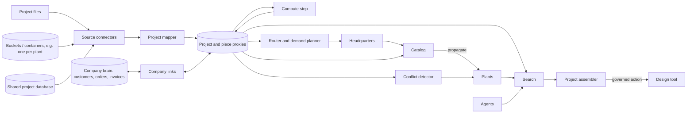

> **Status:** Draft. A domain system hosted alongside the Company brain system, which holds customers, orders and invoices. Kroika, a separate furniture design app, is the first source. Points marked **(interop: review)** depend on interoperability between khoras; points marked *Suggestion* have not been decided.

## 1. Overview

- **System name:** Furniture workshop
- **Purpose:** Turns the design projects of a furniture maker, from one workshop to a company with many plants, into one living model of furniture, parts, materials, prices and production. New furniture and projects are built from what was already designed, priced and made, and work is shared across plants.
- **Scope:**
  - **In:**
    - **Design projects as proxies:** one proxy per project, and child proxies for each piece of furniture, panel, building, item and material inside it. Projects come from files, from object storage (several buckets or containers, e.g. one per plant), or from a shared database, in any format version. Kroika projects (JSON) first; other design tools and cut lists later.
    - **Search** across all projects: by parameters (type, size ranges, front, material), by description, and by similarity of whole projects or single pieces.
    - **Reuse:** assembling a new project from pieces, materials and settings of past projects, written back to the design tool.
    - **Quoting from history:** the price of a new project next to similar past ones.
    - **Materials and prices:** which projects use a material, and the effect of a price change on open projects.
    - **Offcut stock** shared across projects.
    - **Many plants:**
      - Plants as participants, each seeing its own projects, with search and reuse across plants where granted.
      - A company catalog of standard pieces, materials and prices, set centrally and propagated to every plant, with drift flagged.
      - Routing an order to a plant by capacity, machines, stock and distance.
      - Combined material demand and purchasing across plants.
      - Detection of concurrent edits to the same project.
    - **Links to the company:** customers, orders and invoices from the Company brain; emails and photos of the result as proxies.
  - **Out:**
    - Designing furniture. Design tools stay the editors and the system of record for project content.
    - Computing cut lists, cutting layouts and drilling. The design tool's own logic does that.
    - Machine control (CNC), production scheduling inside a plant, accounting, payments.
    - Customers, orders and invoices as models of their own. The Company brain holds them.
- **Stakeholders:**
  - Designers and salespeople who make new projects and quotes.
  - Plants: cutting, drilling, assembly, and plant managers.
  - Headquarters: catalog, prices, purchasing, routing of orders.
  - Owner or management: margins, materials, what sells.
  - Customers, as modeled entities, not users.
  - AI agents that search and assemble projects through the khora API.
- **Success criteria:**
  - The company runs its quoting and new projects through the system.
  - A new project starts from a similar past one in most cases, not from zero, including projects of other plants.
  - Any question like "have we made an L-shaped kitchen with a carousel in Sonoma oak around 3.6 m, where, and what did it cost" is answered in seconds, traced to the projects.
  - A price or catalog change shows which open projects and plants it affects before anyone recalculates by hand.
  - No project content changes unless a person approves the write.

## 2. Context and boundaries

| Element | Description | Source / destination |
| --- | --- | --- |
| Inputs | Design project files, any format version | Shared folders, exports, pointed to by proxies |
| Inputs | Design projects in a shared database (rows with the project as JSON) | Company database, pointed to by proxies |
| Inputs | Design projects as objects in several buckets or containers | Object storage (S3-compatible, Azure Blob, Google Cloud Storage), pointed to by proxies |
| Inputs | Plants: machines, capacity, stock, location | Plant records, Company brain |
| Inputs | Customers, orders, invoices, suppliers | Company brain (commercial, operations and finance packs), or business systems as proxies until it exists |
| Inputs | Emails, photos, notes about an order | Mail, files, pointed to by proxies |
| Inputs | Material and hardware price lists | Suppliers |
| Inputs | Company catalog: standard pieces, materials, prices | Headquarters |
| Outputs | Search results: projects and pieces, with links to the source | People and agents |
| Outputs | New projects assembled from past ones | Design tools, shared folder, bucket or database |
| Outputs | Quote comparisons, price-change impact, material usage | People |
| Outputs | Order routing proposals, combined material demand | Headquarters, plants |
| Outputs | Alerts: catalog drift, concurrent edits, projects with no order | Owners |
| External interfaces | Design tools (Kroika first) | Files and database sync; write-back of new projects |
| External interfaces | Object storage | Storage API with change notifications where available |
| External interfaces | AI agents | khora API, e.g. through MCP |
| External interfaces | Company brain | Shared entities in the same khora; other khoras **(interop: review)** |

The system boundary is:
- **Inside:** proxies of projects and their contents, the catalog, plants as participants, extracted and computed fields, links to orders, search, routing and demand, the action log of every write.
- **Outside:** the content of the projects themselves, the furniture logic of the design tools, production inside a plant, the company's systems of record.

## 3. Requirements

| ID | Type | Requirement | Priority | Verification |
| --- | --- | --- | --- | --- |
| R1 | Functional | The system shall sync design projects from files, from objects in any number of buckets or containers, and from database rows, as one proxy per project, detecting new, changed, moved and deleted projects. | Must | Test: add, edit, move and delete projects in each kind of source; proxies follow after sync |
| R2 | Functional | The system shall treat each bucket or container as its own source with its own credentials and scope, so that a plant's projects can live in its own bucket and still be searched across plants where granted. | Must | Test: three buckets for three plants; each plant sees its own, headquarters sees all |
| R3 | Functional | The system shall use the storage's change notifications where available and fall back to incremental listing, and keep the object's version id so that past versions can be traced. | Should | Test: an object overwritten twice shows both earlier versions in the project's history |
| R4 | Functional | The system shall extract child proxies from the structure inside a project (pieces, panels, buildings, items, materials) by a declared mapping, keyed by their ids within the project. | Must | Test: a piece edited in the design tool updates only its child proxy |
| R5 | Functional | The system shall record the format version of each project and map older versions to the current mapping, flagging what it cannot map instead of dropping it. | Must | Test on projects from several versions of the design tool |
| R6 | Functional | The system shall keep derived data (cut list rows generated from pieces) apart from source data, and mark which is which. | Should | Inspection: a generated part links to its piece |
| R7 | Functional | The system shall answer structured queries with numeric ranges and facets, e.g. "base cabinets 550–650 wide with drawers in material X". | Must | Test query suite on a reference corpus |
| R8 | Functional | The system shall find similar projects and similar pieces by parameters and by description, and explain why a result is similar. | Must | Test: labelled pairs of similar projects rank in the top 5 |
| R9 | Functional | The system shall assemble a new project from selected pieces, materials and settings of past projects, with new ids, as a governed action that writes a new project and never changes the source projects. | Must | Test: the new project opens in the design tool and matches the selection |
| R10 | Functional | The system shall compute project totals (sheets, edge, hardware, price) with the design tool's own logic, not a copy of it, and record the version that produced them. | Should | Test: totals match what the design tool shows for the same project |
| R11 | Functional | The system shall show the effect of a material, hardware or catalog price change on a chosen set of projects and plants. | Should | Test: change one price; affected projects and differences are listed |
| R12 | Functional | The system shall link projects to the customers, orders and invoices of the Company brain, with a confidence per inferred link, and flag projects with no order and orders with no project. | Should | Inspection on a sample company |
| R13 | Functional | The system shall hold an offcut stock as entities, per plant, and give each project the offcuts it may use. | Should | Test: an offcut used in one project is not offered to another |
| R14 | Functional | The system shall model each plant as a participant that sees its own projects, and let projects be searched and reused across plants where a grant allows it. | Must | Test: a plant sees only its projects and those shared with it |
| R15 | Functional | The system shall hold a company catalog of standard pieces, materials and prices, propagate it to every plant, and flag projects and plants that drift from it. | Should | Test: a catalog change reaches every plant; a deviating project is flagged |
| R16 | Functional | The system shall propose a plant for an order from capacity, machines, stock and distance, and explain the proposal. A person decides. | Should | Test on sample orders with known best plants |
| R17 | Functional | The system shall compute combined material and hardware demand across plants for open projects over a period. | Should | Test: demand matches the sum of the projects' totals |
| R18 | Functional | The system shall detect concurrent edits to the same project from different people or plants and flag them with both versions. | Must | Test: two edits to one project raise a conflict with both versions kept |
| R19 | Performance | *Provisional:* first sync of [100 000] projects within [30 min], and a few changes within [10 s]; a structured query within [500 ms]; search does not query the shared database for every request. | Should | Load test on a generated corpus |
| R20 | Reliability | Every write (new project, catalog change, stock change) is in the action log and can be undone; any past state of a project is reconstructable. | Must | Log replay |
| R21 | Security | Access is scope-based per plant, role and customer. Prices and margins are visible only to roles that need them. | Must | Access tests, audit |

Each requirement is atomic, testable, and traceable to a stakeholder need.

## 4. Architecture

- **Components:**
  - **Source connectors:** keep project proxies synced with files, with objects in buckets and containers, and with database rows. One source per folder, bucket, container or table.
  - **Project mapper:** turns the structure inside a project into child proxies by a declared mapping, per design tool and format version.
  - **Compute step:** runs the design tool's own furniture, cutting and pricing logic as a process step and stores the totals as computed fields.
  - **Search:** structured filters, description search and parameter similarity over projects and pieces, with the reason for each match.
  - **Project assembler:** builds a new project from selected proxies as a governed action, and writes it back to the design tool's source.
  - **Catalog:** standard pieces, materials and prices, propagated to the plants, with drift detection.
  - **Plant model:** plants as participants, with machines, capacity, stock and location.
  - **Router and demand planner:** proposes a plant for an order, and sums demand across plants.
  - **Conflict detector:** finds concurrent edits from the action log and the sources.
  - **Company links:** links projects to customers, orders and invoices of the Company brain.
- **Interactions:**

- **Data:**
  - **Entities:**
    - Proxies: DesignProject (file, object in a bucket, or database row), Piece (cabinet, wardrobe, table…), Panel, Building, Item, Material (as used in a project), Part (derived from a piece or panel, or typed by a person).
    - Internal: Plant, Machine, StorageSource (a folder, bucket, container or table, with its scope), CatalogEntry (a standard piece, material or price), Offcut, Note.
    - From the Company brain: Customer, Order, Invoice, Supplier.
  - **Where they live:**
    - Project content stays in its source, as proxies, and the source stays its truth.
    - Plants, machines, the catalog, offcuts and notes are internal.
    - Totals, descriptions, similarity, links to orders, routing proposals, demand and drift are computed.
    - Every write is in the action log.
- **Behavior:**
  - **The loop:** sync → map → compute → search → assemble → approve → write → sync.
  - **Sync:** a new project adds a proxy and its children; a changed project updates only the children that changed; a deleted project is marked and swept.
  - **Reuse:** select → assemble → preview totals → approve → write → open in the design tool.
  - **Catalog:** headquarters changes an entry → it reaches every plant → projects that use it show the new price; projects that deviate are flagged.
  - **Order routing:** order arrives → candidate plants with reasons → a person decides → the project is placed in that plant's scope.
  - **Failure handling:**
    - Content that is not a project is skipped and reported.
    - A project of an unknown version is indexed by what maps and flagged.
    - A failed compute step leaves totals empty with the error, never stale numbers shown as current.
    - A failed sync keeps the last good version and marks it stale.
    - An unreachable bucket or expired credentials mark that source stale and alert its owner; other sources keep syncing.
    - Concurrent edits keep both versions and are flagged, never silently merged.
    - Content the project references but does not hold (e.g. imported 3D models) is flagged as incomplete.
- **Depends on khora:** proxies for files, objects in buckets and containers, and database rows, child proxies from the structure inside a source, the process runtime with a compute step, governed actions with write-back, the action log, scopes and principals, propagation and drift (as in the Company brain), and interoperability between khoras when plants become their own khoras **(interop: review)**.

## 5. Constraints, assumptions and risks

- **Constraints:**
  - Design tools keep their formats; the system adapts to them, not the other way around.
  - The design tool's logic is reused through a compute step and never reimplemented.
  - Kroika keeps projects in each browser today; until it can save to a folder or a shared database, projects reach the system only as exported files.
  - Until interoperability exists, plants are scopes in one khora. **(interop: review)**
- **Assumptions:**
  - Projects are kept in known places per company or plant (folders, buckets, containers or a database), or can be exported there.
  - Projects carry enough to identify their customer and order often enough to link them.
  - Parameter similarity (sizes, types, fronts, materials) is a good proxy for "a similar piece of furniture".
  - Plants agree to share at least their project structure with headquarters.
- **Risks:**

| Risk | Impact | Mitigation |
| --- | --- | --- |
| A design tool's format changes and the mapping silently breaks | High | Format version per project, flagged unmapped content, a contract test per tool version |
| Prices, margins or customers leak between plants or roles | High | Scopes per plant and role; prices with their own access; audit |
| The system loads the shared database | High | Incremental sync by change time, search served from the index, read-only access |
| Listing and reading many buckets costs money and time | Medium | Change notifications first, incremental listing by prefix and change time, reads only of changed objects |
| Storage credentials leak or are too broad | High | One read-only credential per source, write only for the write-back path, short-lived where the storage allows |
| Concurrent edits overwrite each other in the source | High | Conflicts flagged with both versions; writes as governed actions |
| Derived parts are stale after a design tool's logic changes | Medium | Mark derived parts; recompute with the compute step and compare |
| Assembled projects collide on ids or reference missing materials | Medium | New ids on assemble, materials copied with the pieces, open-in-tool test |
| The catalog constrains plants that need local variants | Medium | Extend, never modify; drift is information, not an error |
| Similarity results feel random | Medium | Explain each match; tune weights on labelled pairs |

## 6. Verification

- **Generated corpus:** use Kroika's own generator to produce [100 000] varied projects across several plants and format versions, as files, as objects in several buckets and as database rows, for sync, search and load tests.
- **Round-trip:** every assembled project opens in the design tool and its totals match the compute step.
- **Query suite:** a fixed set of workshop and headquarters questions with known answers on the corpus.
- **Similarity check:** labelled pairs of similar and different projects.
- **Access tests:** each plant and role sees only what it is granted.
- **Conflict test:** concurrent edits to one project from two plants.
- **Log replay:** every write is reconstructed and undone from the action log.
- **Pilot:** the Kroika author's own projects first, then one workshop, then a company with at least two plants.

## 7. Open questions

- [ ] Where do workshops keep their projects today: browsers, shared folders, cloud drives, a database?
- [ ] Should Kroika first get a format version and saving to a folder or a shared database, so that the system reads projects directly?
- [ ] Which shared database, and does the system read it directly or through an export?
- [ ] Which object storage (S3-compatible, Azure, Google), one bucket per plant or one bucket with a prefix per plant, and are change notifications available?
- [ ] Is object versioning turned on in the buckets, and does the system rely on it for history?
- [ ] How is a project linked to its customer and order: by name, a field in the project, or a link made by a person?
- [ ] Is a reused piece a copy, or a link to a catalog entry that updates everywhere?
- [ ] Who owns the catalog, and which deviations may a plant make without approval?
- [ ] Who decides where an order goes, and from which signals?
- [ ] Do plants become their own khoras, or stay scopes? **(interop: review)**
- [ ] Which similarity matters most to a designer: size, look (front, material) or construction?
- [ ] Do prices in old projects stay as they were, or follow the current price list?
- [ ] Which design tools besides Kroika matter first?

## Considerations: scenarios

> Examples of what people and agents do with the system, for review.

1. **Find a similar project:** "L-shaped kitchen around 3.6 m, carousel corner, Sonoma oak" → filters on type, layout, corner and material, then similarity → 5 projects with plant, price and photos.
2. **Reuse a piece:** "the wardrobe from the Petrovi project, but 20 cm wider and in white" → a new project with the piece changed and its new price.
3. **Quote from history:** a new project's total next to the actual totals of the 10 most similar past projects.
4. **Price change:** Sonoma oak goes up 8% → which open projects in which plants use it, and by how much each changes.
5. **Popular configurations:** the most common widths and fronts in the last year → candidates for the company catalog.
6. **Batch cutting:** several open orders in the same material and plant → one combined cutting run to save sheets.
7. **Offcuts:** offcuts from all projects of a plant in one stock; a new project gets the ones that fit.
8. **Customer history:** everything made for one customer, in any plant, with dates, invoices and emails.
9. **Across plants:** a plant gets an unusual order → finds that another plant has made three like it, and reuses their project.
10. **Order routing:** a kitchen order for Varna → the system proposes the plant with free capacity and the material in stock, with reasons; a manager decides.
11. **Purchasing:** combined demand of all plants for the next month → one order to the supplier.
12. **Catalog drift:** plants that keep using a cabinet width the catalog has replaced.
13. **Conflict:** two designers in two plants edit the same project → both versions are kept and flagged.
14. **Agent work:** an agent through the khora API: "make a kitchen like the one for the Ivanovi, 30 cm shorter, with drawers under the hob" → a draft waiting for approval.
