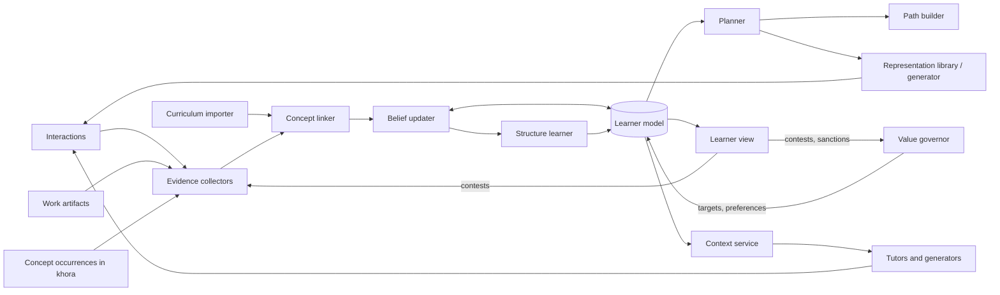

## 1. Overview
 
- **System name:** Lifelong learning
- **Purpose:** Keeps a dynamic model of a person as a learner and uses it to decide what, how and when they learn. Learning toward the person's own targets becomes efficient, engaging and traceable, across a lifetime rather than a single course.
- **Scope:**
  - **In:**
    - A learner model: a dynamic, hierarchical generative model of the learner, held as data in the khora.
    - Beliefs about the learner's relation to concepts that occur anywhere in the khora: work, hobbies, other domain systems.
    - Curricula that are imported, generated or a mix of both, expressed as paths over concepts.
    - Multiple representations per concept, selected and generated by measured value.
    - Action selection across timescales: the next item, the session, the path, and long-term targets.
    - Construction of learning paths to targets.
    - Value training (shaping what the learner values and finds relevant) under the learner's governance.
    - Evidence from interactions with the system and from imported work artifacts.
  - **Out:**
    - Outward-facing scoring, grades and credentials.
    - Child-specific features and multiple principals (parents, teachers, schools).
    - Delivering tutoring dialogue. Tutors are consumers of the system.
    - Authoring of imported course material.
    - Clinical assessment, such as diagnosing learning disabilities.
  - **Extensions (later):**
    - Capture of all work done in the khora as evidence.
    - Physiological and attention signals.
    - Outward scoring.
    - Children and multi-principal learning.
    - Integration with other domain systems.
- **Stakeholders:**
  - Learners: self-directed adults first, designed for lifelong use.
  - Tutors and content generators, AI agents or people, as consumers of the learner model.
  - Curriculum and content providers, as sources.
  - Other systems in the khora whose entities contain concepts.
  - Later: parents, teachers and institutions.
- **Success criteria:**
  - Learners run their learning actively through the system: targets, curricula and practice.
  - Learners reach their targets with less effort than they would on their own.
  - The model's picture of the learner is accurate and keeps improving: it predicts how the learner will do on material they have not seen yet.
  - Most of what the system knows about the learner is inferred from behavior, not asked.
  - Every belief about the learner and every action the system takes traces to evidence.
## 2. Context and boundaries
 
| Element | Description | Source / destination |
| --- | --- | --- |
| Inputs | Interaction events: responses, latency, errors, hint use, choices, skips, abandonment, self-explanations | Representations served by the system |
| Inputs | Work artifacts: notes, code, documents, projects | Khora entities and proxies (e.g. a synced Obsidian vault) |
| Inputs | Concept occurrences: where a concept appears in the learner's work, hobbies and other systems | Khora |
| Inputs | Curricula and course material: syllabi, courses, textbooks, standards | External sources, imported as proxies |
| Inputs | Targets and goals | Learner |
| Inputs | Answers to probes | Learner |
| Outputs | Next actions and sessions | Learner, through representations |
| Outputs | Learning paths to targets | Learner |
| Outputs | Generated representations: explanations, examples, exercises, games, simulations | Representation library, learner |
| Outputs | Explanations of the model's beliefs (open learner model) | Learner |
| Outputs | Value change proposals | Learner, for sanction |
| Outputs | Scoped learner context: relevant beliefs, misconceptions, next targets | Tutors and generators |
| External interfaces | AI tutors and content generators | khora API |
| External interfaces | Course platforms and content sources | Import / sync |
| External interfaces | Note and practice tools | File sync as proxies |
| External interfaces | Other domain systems in the khora | Shared concept space |
 
The system boundary is:
- **Inside:** the learner model and its versions, beliefs and their evidence, curricula as paths, targets and values, the action policy, and generated representations.
- **Outside:** the concepts themselves, which belong to the khora as a whole and not to this system; source course material; tutors' dialogue; and the learner's work itself.
## 3. Requirements
 
| ID | Type | Requirement | Priority | Verification |
| --- | --- | --- | --- | --- |
| R1 | Functional | The system shall hold beliefs, with uncertainty, about the learner's hidden states per concept (e.g. mastery, retention, misconceptions) and per session (e.g. cognitive load, attention, motivation). | Must | Calibration test: predicted probabilities match observed outcome frequencies |
| R2 | Functional | The system shall compute beliefs from evidence, never store them as facts, and trace each belief to the evidence and model version that produced it. | Must | Log replay reconstructs every belief |
| R3 | Functional | The system shall hold the learner model as data in the khora and change its structure at runtime (add, remove, merge or relink states and dependencies) when evidence supports it. Every structural change is versioned and reversible. | Must | Test: inject evidence of an unmodeled dependency; the structure updates and can be rolled back |
| R4 | Functional | The system shall reference concepts from the khora's shared concept space instead of keeping private copies. Any concept that occurs in the khora can be learned, and its occurrences count as evidence of relevance and, where applicable, of use. | Must | Test: a concept used in a work project appears in the learner model with relevance traced to that occurrence |
| R5 | Functional | The system shall import curricula as proxies and map their units to concepts, flagging unmapped content instead of dropping it. | Must | Inspection of mapping reports |
| R6 | Functional | The system shall construct paths to a target over the concept graph, given current beliefs, from imported units, generated units or both. | Must | Test: paths respect prerequisites and skip what the learner already masters |
| R7 | Functional | The system shall keep several representations per concept and choose among them per learner and moment, including different paths to the same concept for interleaving. | Must | Inspection; analysis of representation choice over sessions |
| R8 | Functional | The system shall frame a concept either through concepts the learner already holds well (e.g. code and software terms for a programmer) or in the concept's own terms to extend the learner's mental model. It chooses by the target and by measured effect, and links the framings so the learner can move between them. | Must | Test: for a learner strong in one domain, representations anchored in it are chosen when the target is use in that domain, and native-frame ones when the target is the concept itself; effects compared |
| R9 | Functional | The system shall select the next action by expected value, combining information gain about the learner with progress toward targets, across moment, session, path and long-term timescales. | Must | Simulation with synthetic learners; comparison against fixed schedules and standard spaced repetition |
| R10 | Functional | The system shall keep estimated cognitive load within a target band, adjusting difficulty, representation and pacing. | Should | Synthetic learners; pilot error and latency signatures |
| R11 | Functional | The system shall infer interests, preferences and effective modalities from behavior. It asks the learner directly only when the expected information gain outweighs the cost of asking, and logs the reason. | Must | Inspection of direct-question rate and logged reasons |
| R12 | Functional | The system shall choose modality and representation by their measured effect on the learner, not by stated preference. | Must | Within-learner comparison of representations |
| R13 | Functional | The system shall generate representations (explanations, exercises, games, simulations) from domain models, tag each with the concepts it exercises, measure its effect and retire ineffective ones. | Should | Effect tracking per representation |
| R14 | Functional | The system shall propose changes to the learner's values (relevance weights, targets) only with a reason traceable to a goal the learner set. A change applies only after the learner sanctions it and can be reverted at any time. | Must | Audit: every applied value change has a sanction and a trace |
| R15 | Functional | The system shall let the learner view any belief, see why it is held, and contest it. A contested belief is re-estimated with the contest as evidence, not overwritten. | Must | Test: contest a belief; it is re-estimated and the change is logged |
| R16 | Functional | The system shall let beliefs decay and their uncertainty grow without new evidence. No belief about the learner is permanent. | Must | Test: beliefs drift toward priors over time without evidence |
| R17 | Functional | The system shall give tutors and generators a scoped learner context through the khora API and record their interactions with the learner as evidence. | Must | Test: a consumer sees only what its scope grants; its interactions update beliefs |
| R18 | Performance | Action selection and belief updates keep pace with interactive use: the learner is not left waiting on the model. Concrete targets are set after profiling a first implementation. | Should | Profiling during the pilot |
| R19 | Reliability | Any past state of the learner model, its beliefs and its decisions is reconstructable from the action log. No evidence is lost. | Must | Log replay |
| R20 | Security | The learner model is private to the learner by default. Any sharing is scoped, explicit and revocable, and every access is logged. | Must | Access tests, audit |
 
Each requirement is atomic, testable, and traceable to a stakeholder need.
 
## 4. Architecture
 
- **Components:**
  - **Evidence collectors:** turn interactions, work artifacts and concept occurrences into evidence entities.
  - **Concept linker:** links evidence, curriculum units and representations to concepts in the shared concept space, with a confidence per link; flags unmapped content.
  - **Learner model:** the hierarchical generative model held as data: hidden states, how they produce observations, how they change over time, and the learner's preferences as priors over outcomes.
  - **Belief updater:** approximate inference over the learner model; updates beliefs and their uncertainty from new evidence.
  - **Structure learner:** proposes and applies changes to the model's structure when persistent prediction error shows the model is missing something; versions every change.
  - **Planner:** selects actions by expected free energy across timescales, balancing information gain against progress toward targets.
  - **Path builder:** constructs paths to targets over the concept graph.
  - **Curriculum importer:** ingests and syncs external curricula as proxies.
  - **Representation library and generator:** holds and generates representations per concept, in frames drawn from what the learner already knows or in the concept's own terms; tracks each one's measured effect.
  - **Value governor:** manages targets and value proposals, sanction and revert.
  - **Learner view:** the open learner model; shows beliefs, reasons, paths and pending proposals, and accepts contests.
  - **Context service:** serves scoped learner context to tutors and generators through the khora API.
- **Interactions:**

 
- **Data:**
  - **Entities:**
    - Learner.
    - Concept: khora-wide, not owned by this system.
    - ConceptRelation: prerequisite, part-of, analogy, contrast.
    - Occurrence: a concept appearing in a khora entity, such as a work project, a hobby or another system.
    - Curriculum (imported, generated or mixed), CurriculumUnit, Path, Target.
    - Representation: explanation, example, exercise, game or simulation; its modality; the concepts it exercises; the concepts it is framed through; its measured effect.
    - Interaction, Evidence.
    - Belief: a hidden-state estimate with uncertainty, per concept or per session.
    - Misconception.
    - ModelVersion (structure and parameters), StructureChange.
    - Action: a served activity or probe, with its rationale.
    - Preference: a prior over outcomes. ValueProposal.
  - **Where they live:**
    - Concepts, their relations and their occurrences belong to the khora at large.
    - Source curricula stay external as proxies.
    - The learner model, targets and values are internal and private to the learner.
    - Beliefs, paths and action choices are computed.
    - Interactions and evidence live in the action log.
- **Behavior:**
  - **The loop:** observe → update beliefs → update structure if warranted → plan → act → observe.
  - **Timescales:** each level sets priors for the level below, and each lower level sends evidence up.
    - **Moment** (seconds to minutes): cognitive load and attention. Chooses the next item, a hint, a different representation or a pause.
    - **Session** (minutes to hours): interleaving, spacing, session length and mix of new and review.
    - **Path** (weeks to months): the sequence of concepts toward a target.
    - **Life** (years): targets, values and relevance.
  - **Framing:** a familiar frame (e.g. code for a programmer) lowers load and speeds use in that domain; the concept's own frame extends the learner's mental model. The planner weighs both against the target, and once a concept is held in one frame, re-expressing it in another is itself a path to deeper mastery.
  - **Cold start:** begins from population-level priors and the concept graph. Early actions are weighted toward information gain. Imported artifacts, such as an existing notes vault, bootstrap beliefs.
  - **Failure handling:**
    - Under high uncertainty, the planner prefers information-gathering actions over confident teaching.
    - Persistent prediction error triggers structure learning instead of forcing a fit.
    - Unmapped content and low-confidence concept links are flagged.
    - Representations with poor measured effect are retired.
    - A value proposal without a reason traceable to a learner goal is never made.
    - Disengagement is treated as evidence about the model, not as a failure of the learner.
## 5. Constraints, assumptions and risks
 
- **Constraints:**
  - Exact active inference over a large concept graph is intractable. Inference is approximate, factorized along the concept graph and hierarchical.
  - Evidence is partial: until the work-capture extension, much of the learner's learning happens outside the system.
  - The learner model is among the most sensitive data a khora holds, and khora's security model is not yet specified.
  - Tutors and generators are external consumers. The system can measure their effect but cannot guarantee their quality.
- **Assumptions:**
  - Behavioral signals (accuracy, latency, choices, hints, abandonment) carry enough information to infer the hidden states that matter.
  - Concepts can be identified and linked across contexts with acceptable precision.
  - Self-directed learners will accept being asked little and guided by inference, given that the model is transparent.
  - Robust learning-science findings (retrieval practice, spacing, interleaving, worked examples, cognitive load) work as priors for the model.
- **Risks:**
| Risk | Impact | Mitigation |
| --- | --- | --- |
| The model locks onto a wrong picture of the learner and makes it self-fulfilling | High | Decay, explicit uncertainty, contestable beliefs, built-in exploration |
| Value training becomes manipulation | High | Sanction before applying, traceability to learner goals, visibility, revert |
| The system optimizes engagement over learning | High | Pragmatic value tied to targets and delayed retention, not time in the system; novelty serves learning, not attention |
| Learner model data is exposed | High | Private by default, scoped and revocable sharing, access audit |
| Inference is too slow or becomes intractable | Medium | Factorization, hierarchy, cached and amortized policies |
| Generated content is wrong | Medium | Concept tagging, cited sources, effect measurement, retirement of weak content |
| Concept linking errors corrupt beliefs | Medium | Link confidence, flags for low-confidence links, learner correction |
 
## 6. Verification
 
- **Synthetic learners:** simulate learners with known hidden states and structure. Check that beliefs and structure are recovered, and compare the policy against fixed schedules and standard spaced repetition.
- **Predictive validity:** predictions on held-out items, calibration, and the trend of prediction error per learner.
- **Within-learner experiments:** alternate policies across periods or concepts and compare time to target and delayed retention.
- **Pilot:** a small cohort of self-directed learners, starting with the system authors' own khoras and importing existing notes. Measure time to target, delayed retention, sustained use and direct-question rate against each learner's baseline.
- **Transfer probes:** check that concepts are recognized and applied where they occur elsewhere in the khora.
- **Log replay:** reconstruct beliefs, model versions and decisions from the action log.
- **Governance audit:** every applied value change has a sanction and a trace to a learner goal.
## 7. Open questions
 
- [ ] Which hidden states per concept beyond mastery and retention: fluency, transfer, confidence calibration?
- [ ] Structure learning: what evidence triggers adding, merging or relinking states and concepts, and which changes need the learner's approval?
- [ ] Concept identity across contexts: when are two occurrences the same concept, and at what granularity?
- [ ] Who curates the shared concept space: does this system propose concepts while the khora owns them?
- [ ] How much of the policy is learned per learner and how much comes from shared priors, and how are pooled priors kept private?
- [ ] Which value changes need explicit sanction and which count as minor tuning?
- [ ] What is a target: a set of concepts, a capability, a project outcome?
- [ ] How is engagement measured without becoming an objective?
- [ ] Integration with other domain systems.
- [ ] Framing (R8): how does a target express whether the learner wants a concept in a familiar frame, a new one, or both?
- [ ] Performance targets in R18, once a first implementation is profiled.
- [ ] When outward scoring arrives: what it measures and who sees it.
 